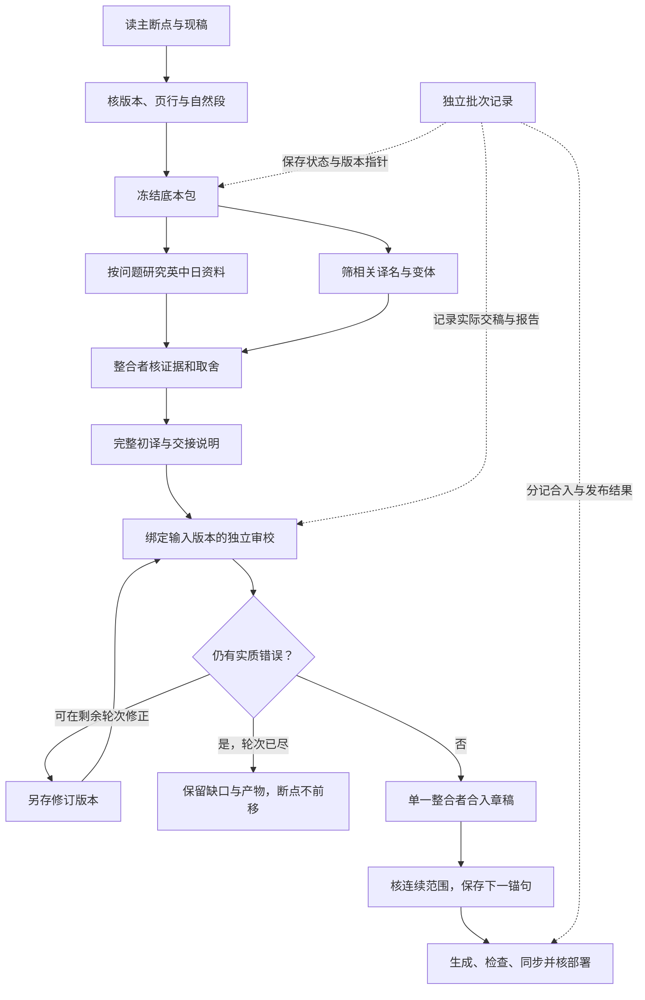

# 译注技能架构与交接约定

本工程参考 [QriDoki 项目技能](https://github.com/QriDoki/in-search-of-lost-time-translation-project/tree/main/.ai/skills) 的章节协调、译者、校对者和术语维护分工，按 Joyce 稿件结构重写。这里规定阶段、产物与回写关口；具体执行另读对应技能。篇幅不能代替核查，角色名称也不能证明学术资历。

本轮参考版本为 `cdc48f036496c554da3d77e0f0b0ca06ec4ce332`；分别查阅 `contribute`、`epub-to-md`、`translate-multi-md` 及后者四份角色文档。承接其阶段交稿、章节串行、相关术语、独立审校与上下文衔接；改用本库 JSON 权威稿、页行锚句、逐注出处、三语研究和实际并发上限。不沿用普鲁斯特身份设定、按位置跳首末、删图、非空即完成或失败后复制初译充作审校终稿。

## 权威稿与工作资料

读本只从 `manuscript/chapters/*.json`、`sources/catalog.json`、`glossary/terms.json` 构建。`reports/` 保存研究、交稿和取舍依据，不直接发布为译文。`raw-md/`、`translated-md/`、`polish/dev/`、`annotations/` 与进度便读稿均由工具生成。

`scripts/project.py check` 只查现有数据规则。它不读取研究报告，不判定词源成立，不检验工作包阶段，也不能证明页行之间没有漏文。工作包和审校关口由整合者逐项比对。当前没有后台自动调度器；技能约定人工或代理怎样执行这套流程。

普通词义或已有依据足够时，研究分支记不触发及理由。图中研究与术语可并行，初译和审校不能抢写同一版本。

## 七项技能与触发

1. `prepare-source`：确定见证本、分段、页行与录文差异，交底本包。
2. `joyce-research`：对实际问题检索英、中、日研究，核跨文本关系，交逐主张证据及异议。
3. `maintain-glossary`：核跨段译名和变体，交增量及冲突裁定。
4. `translate-chapter`：按连续段落初译，保留初译与采用稿，解释声形取舍。
5. `review-translation`：独立核译义、注释、出处与中文，交可定位意见。
6. `checkpoint`：保存连续范围、下一锚句、未决问题和上下文，处理中断。
7. `contribute`：核差异、构建、合并远端变动并同步，确认部署。

入口见根目录 `AGENTS.md`。研究不必每段重做全套：新典故、跨作指认、相互矛盾的解释、重大译名或无据注释才触发深入核查。默认检索三语，但允许某语无可得正文；不得凑齐三条引文充数。

## 验收关口与退出条件

每个稳定段落 ID 同时也是交接 ID。一轮可做一至两个自然段，各段分别保存工作包。章节串行；同段各阶段有先后关系。下表名称是验收关口，不是持久记录的 `stage` 枚举。

| 验收关口 | 输入 | 交付 | 整合者验收后才可前进 |
| --- | --- | --- | --- |
| `source_ready` | 断点、见证本、前段 | `reports/workpacks/<id>.json` | 页行与段界已核；异文、原文和版本明确；下一锚句可定位 |
| `research_ready` | 具体问题、原句及候选读法 | `reports/research/<id>/` | 分清主张、证据、解释与译法影响；可访问程度、转引及反证明说 |
| `terms_ready` | 相关旧译名、研究结果 | `reports/glossary/<batch-id>.delta.json` 与相关译名清单 | 与当前术语表比对；冲突已有临时决定，未强改全书 |
| `draft_ready` | 底本包、相关术语与前文 | `reports/drafts/<id>.json` | 是完整段落对象；原文和坐标与包一致；初译不空 |
| `review_ready` | 固定版本初译、实际来源 | `reports/reviews/<id>.r0.md`，修订复核用 `.r1.md`、`.r2.md` | 写明所审输入；漏译、无据增补、注释和中文均已检查；限度明确 |
| `integrated` | 初译、意见、采用决定 | 章稿、来源、术语、断点与上下文 | 只有整合者回写；没有重复段、悬空来源或越过缺口 |
| `published` | 通过检查的整合稿 | 远端提交及部署结果 | 远端内容、提交和页面对应；失败便保留本地成果并记录原因 |

`research_ready`、`terms_ready` 可记「本批不触发」及理由，不能生成空报告假装做过研究。是否触发的初始决定存输入包，实际完成状态与产物路径存批次记录。现有段落状态只有 `draft`、`revised`、`reviewed`；全章 `coverage` 另算。

每批用 `reports/batches/<batch-id>.json` 汇总当前状态、输入、交付路径、尝试次数和未决项，沿用 [批次模板](../templates/batch.json)。它是手工维护的交接记录，当前构建工具不自动执行或验收。输入包冻结后不再回写状态，避免阶段变化使输入指纹失效。

`segments.<id>.stage` 统一使用：`preparing`（准备中）、`prepared`（底本已核，研究／译名是否就绪另验）、`drafted`（完整初译已交）、`pending_review`（等待独立审校）、`needs_revision`（有待修问题）、`ready_to_integrate`（本批关口通过）、`integrated`（已合入）或 `blocked`（有阻断缺口）。只有经过相应关口才能前进；研究或术语不就绪时，留在 `prepared` 并记缺项。学术分歧可保留为存疑，不等于缺原文、漏译等阻断问题。

发布单列 `publication.state`：`not_published`、`pushed`、`deploying`、`published`、`failed`。上传不改变已合入的翻译阶段，部署失败也不把译文重置为未译。输入包与审校报告不可因状态改变而改写。

## 固定输入与过期判定

底本包采用 [模板](../templates/workpack.json)。`baseline` 记录本批读入的章稿、来源表和术语表 SHA-256。它只用于辨认文件版本，不能证明文字真实或注释正确。可用 Python 标准库 `hashlib.sha256(Path(path).read_bytes()).hexdigest()` 计算，无须安装依赖。核好后冻结；输入更正另存版本，旧包与旧报告保留，批次记录指向实际采用版本。

译者逐字承接底本包中的 `original`、ID、范围及 `source_id`。审校报告列出所审交稿路径、SHA-256、日期和校阅范围。写入章稿前重读当前文件并核差异：

- 只有无关来源或别段修改时，保留其改动，确认本批输入未变，再整合。
- 本批原文、术语或译文已变时，旧审校不再覆盖新稿；把变化交回对应角色核对。
- 不一致不能靠覆盖现稿或重新计算指纹掩盖；先说明差异，再作合并决定。

指纹是轻量交接工具。无需为每个短句重复计算，也不为所有研究网页制作整站快照。

## 研究怎样进入读本

研究技能保存四层信息：`claim` 是待检验主张；`evidence` 是实际读过的材料与位置；`interpretation` 是来源或项目怎样解释它；`translation_impact` 是它会改变哪个词、译句或注释。四层不能互相代替。

整合者逐项决定采用、并列、降级或暂缓。来源先登记到来源表，采用内容再写进段落 `notes` 或 `alternatives`。未采用理由留在研究／审校报告；候选结论不会因文件存在便进入读本。外部资料要概括与链接，不能整段搬成项目注释。

`supported` 表示所列来源支持该说，仍须区分原著事实、学者解释与译者判断。只有词形相似、二手转述或检索摘要时，不能把互文或作者意图标成已证。英、中、日研究对同一问题有分歧时，保存各自依据，不投票决定真相。

## 分工与并发

整合者保留公共章稿、来源表、术语表、断点及远端引用的写入权。译者、研究者、术语维护者、审校者只写分配的工作文件；不得互相覆盖。调用时明确文件归属，并提醒所有角色保留他人改动。

可独立的问题并行检索；同段初译须先有底本，审校须先有完整交稿。章节之间不为提速跳译。根代理计入并发上限；本环境最多四个同时活动角色。角色可分时复用，不强制凑齐七名代理，也不在子层无限递归开代理。

小批次可由同一执行者依次完成各阶段，但须说明没有独立审校。AI 审校不是人工审校；`reviewers` 只登记真正核过底本、出处和中文的人。

## 故障与恢复

- 原文或页行对不上：停在该段核对，不凭后文猜补。
- 资料只见摘要或付费墙：登记访问层级；可交有限判断，不能声称读过全文。
- 三语检索有空白：记检索范围和日期，保留问题；检索不到不能证明不存在研究。
- 代理未交完整段落：保留工作包和半稿，主断点不前移；不能以「文件非空」验收。
- 两轮修订后仍有学术分歧：保存备选与未决问题；若不妨碍正文连续，可保留试译；若缺原文或关键动作无法辨认，停在缺口。
- 中断、生成稿滞后、远端冲突或部署失败：按 checkpoint 恢复说明处理，不重译已合入段落，不强推覆盖。

## 可核查的完成标准

单批完成须同时满足：底本范围确定、完整段落合入、来源可解析、审校范围如实登记、断点指向下一段、生成稿同步、检查通过。上传与上线分别确认。

整章完成还须逐项核对全章覆盖并填写 `coverage_review`。已有 IV 篇末样稿不能代表 I–III 已译。全书未译完时，不能用技能完成、目录齐全、格式检查通过或预算耗尽代替翻译目标完成。

现有工具还有两处会在后文触发的兼容限制：

1. 进入 IV 之前，校验器须先区分连续前缀与远段样稿。当前程序拿该章最后一段比较断点，已有的 628.15–628.16 样稿会使真实章首 `[593,1]` 遭拒。本轮已用内存场景复现。不得取较大坐标跳过正文、删样稿或伪造锚句；须先扩校验并验证，再开始 IV 顺序录入。
2. 主断点必须给出章内下一坐标和非空锚句，尚无全书终结状态。实际合入 IV 最后完整正文前，须先扩展断点格式、校验器、生成器及相关测试，再记录全书结束。不得伪造末行之后的下一句，也不能以现有篇末样稿提前触发终结。

这些限制已列为相关技能的前置关口，本轮只完善技能，不宣称已给工具实现新能力。用户可改变或结束工作目标；技能不会自动创建、恢复或延长长期目标。
