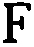
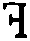
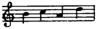
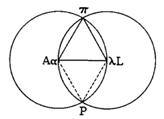
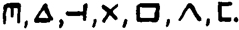
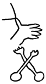

# Nightlessons · 英文底本

<!-- 自动生成；请编辑 manuscript/chapters/II-2.json 的 source_text -->

## FW 260 {#source-page-260}

 

 

 

 

unde et ubi.

As we there are where are we are we there

from tomtittot to teetootomtotalitarian. Tea

tea too oo.

sic.

With his broad

and hairy face,

to Ireland a

disgrace.

Whom will comes over. Who to caps ever.

And howelse do we hook our hike to find that

pint of porter place? Am shot, says the bigguard.1

imaginable

itinerary

through

the

particular

universal.

Whence. Quick lunch by our left, wheel,

Menly about

peebles.

to where. Long Livius Lane, mid Mezzofanti

Mall, diagonising Lavatery Square, up Tycho

Brache Crescent,2 shouldering Berkeley Alley,

Dont retch meat

fat salt lard

sinks down (and

out).

querfixing Gainsborough Carfax, under Guido

d'Arezzo's Gadeway, by New Livius Lane till

where we whiled while we whithered. Old

Vico Roundpoint. But fahr, be fear! And

natural, simple, slavish, filial. The marriage of

Montan wetting his moll we know, like any

enthewsyass cuckling a hoyden3 in her rougey

1 Rawmeash, quoshe with her girlic teangue. If old Herod with the Cormwell's

eczema was to go for me like he does Snuffler whatever about his blue

canaries I'd do nine months for his beaver beard.

2 Mater Mary Mercerycordial of the Dripping Nipples, milk's a queer

arrangement.

3 Real life behind the floodlights as shown by the best exponents of a royal

divorce.

## FW 261 {#source-page-261}

gipsylike chinkaminx pulshandjupeyjade and

her petsybluse indecked o' voylets.
1 When

who was wist was ware. En elv, et fjaell. And

the whirr of the whins humming us howe.

His hume. Hencetaking tides we haply return,

trumpeted by prawns and ensigned with seakale,

to befinding ourself when old is said in

one and maker mates with made (O my!),

having conned the cones and meditated the

mured and pondered the pensils and ogled the

olymp and delighted in her dianaphous and

cacchinated behind his culosses, before a

Swiney Tod, ye

Daimon Barbar!

mosoleum. Length Withought Breath, of him,

a chump of the evums, upshoot of picnic or

stupor out of sopor, Cave of Kids or Hymanian

Glattstoneburg, denary, danery, donnery,

Dig him in the

rubsh!

domm, who, entiringly as he continues highly-

fictional, tumulous under his chthonic exterior

Ungodly old Ardrey,

Cronwall

beeswaxing the

convulsion box.

but plain Mr Tumulty in muftilife,
2 in his an-

tisipiences as in his recognisances, is, (Dominic

Directus) a manyfeast munificent more mob

than man.

constitu-

tion of the

constitu-

tionable as

constitu-

tional.

Ainsoph,3 this upright one, with that

noughty besighed him zeroine. To see in his

horrorscup he is mehrkurios than saltz of

sulphur. Terror of the noonstruck by day,

cryptogam of each nightly bridable. But, to

speak broken heaventalk, is he? Who is he?

Whose is he? Why is he? Howmuch is he?

Which is he? When is he? Where is he?
4 How

is he? And what the decans is there about him

1
When we play dress grownup at alla ludo poker you'll be happnessised
 to feel how fetching I can look in clingarounds.

2
Kellywick, Longfellow's Lodgings, House of Comments III, Cake Walk,
 Amusing Avenue, Salt Hill, Co. Mahogany, Izalond, Terra
Firma.

3
Groupname for grapejuice.

4
Bhing, said her burglar's head, soto poce.

## FW 262 {#source-page-262}

anyway, the decemt man? Easy, calm your

haste! Approach to lead our passage!

proba-

possible

prolego-

mena to

ideareal

history.

This bridge is upper.

Cross.

Thus come to castle.

Knock.1

A password, thanks.

Yes, pearse.

Well, all be dumbed!

O really?
2

Swing the banjo,

bantams, bounce-

the-baller's

blown to fook.

Hoo cavedin earthwight

At furscht kracht of thunder.
3

When shoo, his flutterby,

Was netted and named.
4

Thsight near

left me eyes when

I seen her put

thounce otay

ithpot.

Erdnacrusha, requiestress, wake em!

And let luck's puresplutterall lucy at

ease!
5

To house as wise fool ages builded.

Sow byg eat.
6

gnosis of

precreate

determination.

agnosis of

postcreate

determinism.

Staplering to tether to, steppingstone to

Quartandwds.

mount by, as the Boote's at Pickardstown.

And that skimmelk steed still in the groundloftfan.

As over all. Or be these wingsets leaned

to the outwalls, beastskin trophies of booth

of Baws the balsamboards?
7 Burials be ballyhouraised!

So let Bacchus e'en call! Inn inn!

Tickets for the

Tailwaggers

Terrierpuppy

Raffle.

Inn inn! Where. The babbers ply the pen.

The bibbers drang the den. The papplicom,

the pubblicam he's turning tin for ten. From

1 Yussive smirte and
ye mermon answerth from his beelyingplace below

the tightmark, Gotahelv!

2 O Evol, kool in the salg
and ees how Dozi pits what a drows er.

3 A goodrid croven in a
tynwalled tub.

4 Apis amat aram. Luna legit
librum. Pulla petit pascua.

5 And after dinn to shoot the shades.

6 Says blistered Mary Achinhead
to beautifed Tummy Tullbutt.

7 Begge. To go to Begge. To
go to Begge and to be sure to reminder

Begge. Goodbeg, buggey Begge.

## FW 263 {#source-page-263}

seldomers that most frequent him. That same

erst crafty hakemouth which under the assumed

name of Ignotus Loquor, of foggy old,

harangued bellyhooting fishdrunks on their

favorite stamping ground, from a father theobalder

brake.1 And Egyptus, the incenstrobed,

Mars speaking.

as Cyrus heard of him? And Major A. Shaw

after he got the miner smellpex? And old

Whiteman self, the blighty blotchy, beyond

the bays, hope of ostrogothic and ottomanic

faith converters, despair of Pandemia's postwartem

plastic surgeons? But is was all so

long ago. Hispano-Cathayan-Euxine, Castil-

lian-Emeratic-Hebridian, Espanol-Cymric-

Smith, no home.

Helleniky? Rolf the Ganger, Rough the Gangster,

not a feature alike and the face the same.2

Pastimes are past times. Now let bygones

be bei Gunne's. Saaleddies er it in this warken

werden, mine boerne, and it vild need olderwise3

since primal made alter in garden of

Idem. The tasks above are as the flasks below,

saith the emerald canticle of Hermes and all's

Non quod sed

quiat.

loth and pleasestir, are we told, on excellent

inkbottle authority, solarsystemised, seriol-

cosmically, in a more and more almightily

expanding universe under one, there is rhymeless

reason to believe, original sun. Securely

judges orb terrestrial.
4 Haud certo ergo. But

Hearasay in

paradox lust.

O felicitous culpability, sweet bad cess to you

for an archetypt!

1 Huntler and Pumar's animal
alphabites, the first in the world from

aab to zoo.

2 We dont hear the booming
cursowarries, we wont fear the fletches of

fightning, we float the meditarenias and come bask to the isle we love in

spice. Punt.

3 And this once golden bee a cimadoro.

4 And he was a gay Lutharius
anyway, Sinobiled. You can tell by their

extraordinary clothes.

## FW 264 {#source-page-264}

archaic

zelotypia

and the

odium tel-

eologicum.

Honour commercio's energy yet aid the

linkless proud, the plurable with everybody

and ech with pal, this ernst of Allsap's ale

halliday of roaring month with its two lunar

eclipses and its three saturnine settings! Horn

of Heatthen, highbrowed! Brook of Life, backfrish!

Amnios amnium, fluminiculum flaminulinorum!

We seek the Blessed One, the

Harbourer-cum-Enheritance. Even Canaan

the Hateful. Ever a-going, ever a-coming.

Between a stare and a sough. Fossilisation, all

branches.
1 Wherefore Petra sware unto Ulma:

Bags.

Balls.

By the mortals' frost! And Ulma sware unto

Petra: On my veiny life!

the locali-

sation of

legend

leading to

the legali-

sation of

latifundism.

In these places sojournemus, where Eblinn

water, leased of carr and fen, leaving amont her

shoals and salmen browses, whom inshore

breezes woo with freshets, windeth to her

broads. A phantom city, phaked of philim

pholk, bowed and sould for a four of hundreds

of manhood in their three and threescore

Move up,

Mackinerny!

Make room for

Muckinurney!

fylkers for a price partitional of twenty six and

six. By this riverside, on our sunnybank,
2 how

buona the vista, by Santa Rosa! A field of May,

the very vale of Spring. Orchards here are

lodged; sainted lawrels evremberried. You

have a hoig view ashwald, a glen of marrons

and of thorns. Gleannaulinn, Ardeevin: purty

glint of plaising height. This Norman court at

boundary of the ville, yon creepered tower of

a church of Ereland, meet for true saints in

worshipful assemblage,
3 with our king's house

1 Startnaked and bonedstiff.
We vivvy soddy. All be dood.

2 When you dreamt that you'd
wealth in marble arch do you ever think of

pool beg slowe.

3 Porphyrious Olbion, redcoatliar,
we were always wholly rose marines

on our side every time.

## FW 265 {#source-page-265}

of stone, belgroved of mulbrey, the still that

was mill and Kloster that was Yeomansland,

the ghastcold tombshape of the quick foregone

on, the loftleaved elm Lefanunian abovemansioned,

each, every, all is for the retrospectioner.

Skole! Agus skole igen!
1 Sweetsome

auburn, cometh up as a selfreizing flower,

that fragolance of the fraisey beds: the phoenix,

his pyre, is still flaming away with trueprattight

spirit: the wren his nest is niedelig as the

turrises of the sabines are televisible. Here are

the cottage and the bungalow for the cobbeler

and the brandnewburgher:
2 but Izolde, her

chaplet gardens, an litlee plads af liefest pose,

In snowdrop,

trou-de-dentelle,

flesh and helio-

trope.

arride the winnerful wonders off, the winnerful

wonnerful wanders off,
3 with hedges of

ivy and hollywood and bower of mistletoe,

are, tho if it theem tho and yeth if you

pleathes,
4 for the blithehaired daughter of

Angoisse. All out of two barreny old perishers,

Tytonyhands and Vlossyhair, a kilolitre in

metromyriams. Presepeprosapia, the parent

bole. Wone tabard, wine tap and warm tavern5

and, by ribbon development, from contact

bridge to lease lapse, only two millium two

humbered and eighty thausig nine humbered

Here's our dozen

cousins from the

starves on tripes.

and sixty radiolumin lines to the wustworts of

a Finntown's generous poet's office. Distorted

mirage, aloofliest of the plain, wherein the

1 Now a muss wash the
little face.

2 A viking vernacular
expression still used in the Summerhill district for a

jerryhatted man of forty who puts two fingers into his boiling soupplate and

licks them in turn to find out if there is enough mushroom catsup in the

mutton broth.

3 H' dk' fs' h'p'y.

4 Googlaa pluplu.

5 Tomley. The grown man. A butcher
szewched him the bloughs and

braches. I'm chory to see P. Shuter.

## FW 266 {#source-page-266}

boxomeness of the bedelias1 makes hobbyhodge

happy in his hole.
2 The store and

charter, Treetown Castle under Lynne. Rivapool?

Hod a brieck on it! But its piers eerie,

its span spooky, its toll but a till, its parapets

all peripateting. D'Oblong's by his by. Which

we all pass. Tons. In our snoo. Znore. While

we hickerwards the thicker. Schein. Schore.

Which assoars us from the murk of the mythelated

in the barrabelowther, bedevere butlered

table round, past Morningtop's necessity and

Harington's invention, to the clarience of the

childlight in the studiorium upsturts. Here

we'll dwell on homiest powers, love at the

latch with novices nig and nag. The chorus:

the principals. For the rifocillation of their

inclination to the manifestation of irritation:

doldorboys and doll.
3 After sound, light and

heat, memory, will and understanding.

Bet you fippence,

anythesious,

there's no pug-

gatory, are yous

game?

preausteric

man and his

pursuit of

panhysteric

woman.

Here (the memories framed from walls are

minding) till wranglers for wringwrowdy

wready are, 
, (at gaze, respecting, fourteenth

baronet, meet, altrettanth bancorot,

chaff) and ere commence commencement catalaunic

when Aetius check chokewill Attil's

gambit, (that buxon bruzeup, give it a burl!)

lead us seek, O june of eves the jenniest,

thou who fleeest flicklesome the fond fervid

frondeur to thickly thyself attach with thine

efteased ensuer,
4 ondrawer of our unconscionable,

flickerflapper fore our

1 I believe in Dublin and
the Sultan of Turkey.

2 I have heard this word used by Martin Halpin, an old gardener from the

Glens of Antrim who used to do odd jobs for my godfather, the Rev. B. B.

Brophy of Swords.

3 Ravens may rive so can dove deelish.

4 A question of pull.

## FW 267 {#source-page-267}

unterdrugged,
1 lead us seek, lote us see, light us find,

let us missnot Maidadate, Mimosa Multimimetica,

the maymeaminning of maimoomeining!

Elpis, thou fountain of the greeces, all shall speer

theeward,2 from kongen in his canteenhus to

knivers hind the knoll. Ausonius Audacior

and gael, gillie, gall.3 Singalingalying. Storiella

as she is syung. Whence followeup with endspeaking

There was a

sweet hopeful

culled Cis.

nots for yestures, plutonically pursuant

on briefest glimpse from gladrags, pretty

Proserpronette whose slit satchel spilleth peas.

urges and

widerurges

in a primitive

sept.

Belisha beacon, beckon bright! Usherette,

unmesh us! That grene ray of earong it waves

us to yonder as the red, blue and yellow flogs

time on the domisole,
4 with a blewy blow and

a windigo. Where flash becomes word and

silents selfloud. To brace congeners, trebly

bounden and asservaged twainly. Adamman,5

Emhe, Issossianusheen and sometypes Yggely

ogs Weib. Uwayoei!
6 So mag this sybilette be

our shibboleth that we may syllable her well!

Vetus may be occluded behind the mou in

The Big Bear

bit the Sailor's

Only. Trouble,

trouble, trouble.

Veto but Nova will be nearing as their radient

among the Nereids. A one of charmers, ay,

Una Unica, charmers, who, under the branches

of the elms, in shoes as yet unshent by stoniness,

Forening Unge

Kristlike Kvinne.

wend, went, will wend a way of honey

myrrh and rambler roses mistmusk while still

the maybe mantles the meiblume or ever her

1 For Rose Point see Inishmacsaint.

2 Mannequins' Pose.

3 Their holy presumption and
hers sinfly desprit.

4 Anama anamaba anamabapa.

5 Only for he's fathering law
I could skewer that old one and slosh her out

many's the time but I thinks more of my pottles and ketts.

6 All abunk for Tarararat!
Look slipper, soppyhat, we've a doss in the

manger.

## FW 268 {#source-page-268}

if have faded from the fleur,1 their arms

enlocked, (ringrang, the chimes of sex appealing

Telltale me all

of annaryllies.

as conchitas with sentas stray,2 rung!), all

thinking all of it, the It with an itch in it, the All

every inch of it, the pleasure each will preen her

for, the business each was bred to breed by.3

early

notions of

acquired

rights and

the influ-

ence of

collective

tradition

upon the

individual.

Soon jemmijohns will cudgel about some

a rhythmatick or other over Browne and

Nolan's divisional tables whereas she, of

Will you carry

my can and

fight the fairies?

minions' novence charily being cupid, for

mug's wumping, grooser's grubbiness, andt's

avarice and grossopper's grandegaffe, with her

tootpettypout of jemenfichue will sit and knit

on solfa sofa.
4 Stew of the evening, booksyful

stew. And a bodikin a boss in the Thimble

Theatre. But all is her inbourne. Intend. From

Allma Mathers,

Auctioneer.

gramma's grammar she has it that if there is a

third person, mascarine, phelinine or nuder,

being spoken abad it moods prosodes from a

person speaking to her second which is the

direct object that has been spoken to, with and

at. Take the dative with his oblative
5 for, even

if obsolete, it is always of interest, so spake

gramma on the impetus of her imperative, only

mind your genderous towards his reflexives

Old Gavelkind

the Gamper and

he's as daff as

you're erse.

such that I was to your grappa (Bott's trousend,

hore a man uff!) when him was me hedon
6

and mine, what the lewdy saying, his analectual

pygmyhop.7 There is comfortism in the

1 One must sell it to some one,
the sacred name of love.

2 Making it up as we goes along.

3 The law of the jungerl.

4 Let me blush to think of all
those halfwayhoist pullovers.

5 I'd like his pink's cheek.

6 Frech devil in red hairing!
So that's why you ran away to sea, Mrs

Lappy. Leap me, Locklaun, for you have sensed!

7 A washable lovable floatable doll.

## FW 269 {#source-page-269}

knowledge that often hate on first hearing

comes of love by second sight. Have your

little sintalks in the dunk of subjunctions, dual

in duel and prude with pruriel, but even the

aoriest chaparound whatever plaudered perfect

anent prettydotes and haec genua omniamay

perhaps chance to be about to be in the case to

be becoming a pale peterwright in spite of all

your tense accusatives whilstly you're wallfloored
1

like your gerandiums for the better

half of a yearn or sob. It's a wild's kitten, my

dear, who can tell a wilkling from a warthog.

For you may be as practical as is predicable

but you must have the proper sort of accident

to meet that kind of a being with a difference.
2

Flame at his fumbles but freeze on his fist.
3

Every letter is a godsend, ardent Ares, brusque

Boreas and glib Ganymede like zealous Zeus,

the O'Meghisthest of all. To me or not to me.

Satis thy quest on. Werbungsap! Jeg suis, vos

Undante

umoroso.

M. 50-50.

wore a gentleman, thou arr, I am a quean. Is

a game over? The game goes on. Cookcook!

Search me. The beggar the maid the bigger

οὐκ ἔλαβον

πόλιν

the mauler. And the greater the patrarc the

griefer the pinch. And that's what your doctor

knows. O love it is the commonknounest thing

how it pashes the plutous and the paupe.
4

Pop! And egg she active or spoon she passive,

all them fine clauses in Lindley's and Murrey's

never braught the participle of a present to a

desponent hortatrixy, vindicatively I say it,

1 With her poodle feinting to be let off and feeling dead in herself. Is love

worse living?

2 If she can't follow suit Renée goes to the pack.

3 Improper frictions is maledictions and mens uration makes me mad.

4 Llong and Shortts Primer of Black and White Wenchcraft.

## FW 270 {#source-page-270}

from her postconditional future.1 Lumpsome

is who lumpsum pays. Quantity counts though

accents falter. Yoking apart and oblique orations

I'll go for that

small polly if

you'll suck to

your lebbens-

quatsch.

parsed to one side, a brat, alanna, can

choose from so many, be he a sollicitor's

appendix, a pipe clerk or free functionist

flyswatter, that perfect little cad, from the

languors and weakness of limberlimbed lassihood

till the head, back and heartaches of

waxedup womanage and heaps on heaps of

other things too. Note the Respectable Irish

Distressed Ladies and the Merry Mustard

Frothblowers of Humphreystown Associations.

Atac first, queckqueck quicks after.

Beware how in that hist subtaile of schlangder
2

lies liaison to tease oreilles! To vert embowed

set proper penchant. But learn from that ancient

tongue to be middle old modern to the minute.

A spitter that can be depended on. Though

Wonderlawn's lost us for ever. Alis, alas, she

broke the glass! Liddell lokker through the

leafery, ours is mistery of pain.3 You may spin

on youthlit's bike and multiplease your Mike

and Nike with your kickshoes on the algebrars

O'Mara Farrell.

but, volve the virgil page and view, the O of

woman is long when burly those two muters

Verschwindibus.

sequent her so from Nebob4 see you never

stray who'll nimm you nice and nehm the day.

concomi-

tance of

courage,

One hath just been areading, hath not one,

ya, ya, in their memoiries of Hireling's puny

Ulstria,

wars, end so, und all, ga, ga, of The O'Brien,

1 The gaggles all out.

2 He's just bug nuts on white mate he hasn't the teath nor the grits to choo

and that's what's wrong with Lang Wang Wurm, old worbbling goesbelly.

3 Dear and I trust in all frivolity I may be pardoned for trespassing but I

think I may add hell.

4 He is my all menkind of every desception.

## FW 271 {#source-page-271}

Monastir,

Leninstar and

Connecticut.

counsel

and constancy.

ordination

of omen,

onus and

obit. dis-

tribution

of danger,

duty and

destiny.

polar prin-

ciples.

The O'Connor, The Mac Loughlin and The

Mac Namara with summed their appondage,

da, da, of Sire Jeallyous Seizer, that gamely

Cliopatria, thy

hosies history.

torskmester,
1 with his duo of druidesses in ready

money rompers
2 and the tryonforit of Oxthievious,

Lapidous and Malthouse Anthemy. You

may fail to see the lie of that layout, Suetonia,
3

but the reflections which recur to me are that

so long as beauty life is body love
4 and so bright

as Mutua of your mirror holds her candle to

your caudle, lone lefthand likeless, sombring

Autum of your Spring, reck you not one spirt

of anyseed whether trigemelimen cuddle his

coddle or nope. She'll confess it by her figure

and she'll deny it to your face. If you're not

ruined by that one she won't do you any

whim. And then? What afters it? Gruff Gunne

may blow, Gam Gonna flow, the gossans eye

the jennings aye. From the butts of Heber and

The Eroico

Furioso makes

the valet like

smiling.

Heremon, nolens volens, brood our pansies,

brune in brume. There's a split in the infinitive

from to have to have been to will be. As they

warred in their big innings ease now we never

shall know. Eat early earthapples. Coax Cobra

to chatters. Hail, Heva, we hear! This is the

The hyperape the

mink he groves the

mole you see now for

crush sake, chawley!

glider that gladdened the girl5 that list to the

wind that lifted the leaves that folded the

fruit that hung on the tree that grew in the

garden Gough gave. Wide hiss, we're wizening.

1 All his teeths back to the front, then the moon and then the moon with

a hole behind it.

2 Skip one, flop fore, jennies in the cabbage store.

3 None of your cumpohlstery English here!

4 Understudy my understandings, Sostituda, and meek thine complinement,

gymnufleshed.

5 Tho' I have one just like that to home, deadleaf brown with quicksilver

appliques, would whollymost applissiate a nice shiny sleekysilk out of that

slippering snake charmeuse.

## FW 272 {#source-page-272}

Hoots fromm, we're globing. Why hidest

thou hinder thy husband his name? Leda, Lada,

aflutter-afraida, so does your girdle grow!

Willed without witting, whorled without

aimed. Pappapassos, Mammamanet, warwhetswut

and whowitswhy.1 But it's tails for

toughs and titties for totties and come

Pige pas.

buckets come bats till deeleet.2

panoptical

purview of

political

progress

and the

future pre-

sentation

of the past.

Dark ages clasp the daisy roots, Stop, if you

are a sally of the allies, hot off Minnowaurs

and naval actiums, picked engagements and

banks of rowers. Please stop if you're a

B.C. minding missy, please do. But should

you prefer A.D. stepplease. And if you miss

with a venture it serves you girly well glad.

But, holy Janus, I was forgetting the Blitzenkopfs!

Here, Hengegst and Horsesauce, take

your heads3 out of that taletub! And leave

your hinnyhennyhindyou! It's haunted. The

chamber. Of errings. Whoan, tug, trace,

Seidlitz powther

for slogan

plumpers.

stirrup! It is distinctly understouttered that,

sense you threehandshighs put your twofootlarge

timepates in that dead wash of Lough

Murph and until such time pace one and the

same Messherrn the grinning statesmen, Brock

and Leon, have shunted the grumbling

coundedtouts, Starlin and Ser Artur Ghinis.

Foamous homely brew, bebattled by bottle,

Hoploits and

atthems.

gageure de guegerre.4 Bull igien bear and

then bearagain bulligan. Gringrin gringrin.

Staffs varsus herds and bucks vursus barks.

1 What's that, ma'am? says I.

2 As you say yourself.

3 That's the lethemuse but it washes off.

4 Where he fought the shessock of his stimmstammer and we caught the

pepettes of our lovelives.

## FW 273 {#source-page-273}

Curragh

machree, me

bosthoon fiend.

By old Grumbledum's walls. Bumps, bellows

and bawls.1 Opprimor's down, up up Opima!

Rents and rates and tithes and taxes, wages,

Femilies hug

bank!

saves and spends. Heil, heptarched span of

peace!2 Live, league of lex, nex and the mores!

Fas est dass and foe err you. Impovernment

of the booble by the bauble for the bubble. So

All we suffered

under them Cow-

dung Forks and

how we enjoyed

over our pick of

the basketfild.

Old Kine's

Meat Meal.

wrap up your worries in your woe (wumpumtum!)

and shake down the shuffle for the

throw. For there's one mere ope
3 for downfall

ned. As Hanah Levy, shrewd shroplifter,

and nievre anore skidoos with her spoileds.
4

To add gay touches. For hugh and guy and

goy and jew. To dimpled and pimpled and

simpled and wimpled. A peak in a poke and a

pig in a pew.
5 She wins them by wons, a haul

Flieflie for the

jillies and a

bombambum

for the

nappotondus.

hectoendecate, for mangay mumbo jumbjubes

tak mutts and jeffs muchas bracelonettes

gracies barcelonas.6 O what a loovely freespeech

'twas (tep)7 to gar howalively hintergrunting!

Tip. Like lilt of larks to burdened

crocodile,8 or skittering laubhing at that

wheeze of old windbag, Blusterboss, blowharding

about all he didn't do. Hell o' your

troop! With is the winker for the muckwits

of willesly and nith is the nod for the umproar

napollyon and hitheris poorblond piebold

hoerse. Huirse. With its tricuspidal hauberkhelm

1 Shake eternity and lick creation.

2 I'm blest if I can see.

3 Hoppity Huhneye, hoosh the hen. I like cluckers, you like nuts (wink).

4 Sweet, medium and dry like altar wine.

5 Who'll buy me penny babies?

6 Well, Maggy, I got your castoff devils all right and fits lovely. And am

vaguely graceful. Maggy thanks.

7 My six is no secret, sir, she said.

8 Yes, there, Tad, thanks, give, from, tathair, look at that now.

## FW 274 {#source-page-274}

coverchaf emblem on. For the man that

Murdoch.

broke the ranks on Monte Sinjon. The allriddle

of it? That that is allruddy with us,

ahead of schedule, which already is plan accomplished

Pas d'action,

peu de sauce.

from and syne: Daft Dathy of the Five

Positions (the death ray stop him!) is still, as

reproaches Paulus, on the Madderhorn and,

entre chats and hobnobs,1 daring Dunderhead

to shiver his timbers and Hannibal mac Hamiltan

the Hegerite2(more livepower elbow him!)

ministerbuilding up, as repreaches Timothy,

in Saint Barmabrac's.3 Number Thirty two

West Eleventh streak looks on to that (may

all in the tocoming of the sempereternal speel

From the seven

tents of Joseph

till the calends of

Mary Marian,

olivehunkered

and thorny too.

spry with it!) datetree doloriferous which

more and over leafeth earlier than every

growth and, elfshot, headawag, with frayed

nerves wondering till they feeled sore like any

woman that has been born at all events to the

purdah and for the howmanyeth and howmovingth

time at what the demons in that

As Shakefork

might pitch it.

jackhouse that jerry built for Massa and Missus

and hijo de puta, the sparksown fermament of

the starryk fieldgosongingon where blows

a nemone at each blink of windstill4 they

were sliding along and sleeting aloof and

scouting around and shooting about. Allwhichwhile

or whereaballoons for good

vaunty years Dagobert is in Clane's clean

hometown prepping up his prepueratory

and learning how to put a broad face bronzily

out through a broken breached meataerial

1 Go up quick, stay so long, come down slow!

2 If I gnows me gneesgnobs the both of him is gnatives of Genuas.

3 A glass of peel and pip for Mr Potter of Texas, please.

4 All the world loves a big gleaming jelly.

## FW 275 {#source-page-275}

Puzzly, puzzly,

I smell a cat.

from Bryan Awlining! Erin's hircohaired

culoteer.1

from ceno-

genetic

dichotomy

through

diagonistic

concili-

ance to

dynastic

continuity.

And as, these things being so or ere those

things having done, way back home in Pacata

Auburnia,2(untillably holy gammel Eire) one

Two makes a

wing at the ma-

croscope

telluspeep.

world burrowing on another, (if you've got

me, neighbour, in any large lumps, geek?, and

got the strong of it) Standfest, our topiocal

sagon hero, or any otther macotther, signs is

on the bellyguds bastille back, bucked up with

fullness, and silvering to her jubilee,3 birch-

leaves her jointure, our lavy in waving, visage

full of flesh and fat as a hen's i' forehead,

From the Buffalo

Times of bysone

days.

Airyanna and Blowyhart topsirturvy, that

royal pair in their palace of quicken boughs

hight The Goat and Compasses ('phone

number 17:69, if you want to know4) his seaarm

strongsround her, her velivole eyne aship-

wracked, have discusst their things of the

past, crime and fable with shame, home and

profit,5 why lui lied to lei and hun tried to kill

ham, scribbledehobbles, in whose veins runs

a mixture of, are head bent and hard upon.

Spell me the chimes. They are tales all tolled.
6

Quick quake

quokes the par-

rotbook of dates.

Today is well thine but where's may tomorrow

be. But, bless his cowly head and press his

crankly hat, what a world's woe is each's

1 A pengeneepy for your warcheekeepy.

2 My globe goes gaddy at geography giggle pending which time I was

looking for my shoe all through Arabia.

3 It must be some bugbear in the gender especially when old which they

all soon get to look.

4 After me looking up the plan in Humphrey's Justice of the Pieceit said to

see preseeding chaps.

5 O boyjones and hairyoddities! Only noane told missus of her massas

behaving she would laugh that flat that after that she had sanked down on her

fat arks they would shaik all to sheeks.

6 Traduced into jinglish janglage for the nusances of dolphins born.

## FW 276 {#source-page-276}

other's weariness waiting to beadroll his own

properer mistakes, the backslapping gladhander,
1

Some is out for

twoheaded dul-

carnons but more

pulfers turnips.

free of his florid future and the other

singing likeness, dirging a past of bloody altars,

gale with a blost to him, dove without gall.

And she, of the jilldaw's nest
2 who tears up

Omnitudes in a

knutshedell.

lettereens she never apposed a pen upon.3 Yet

sung of love and the monster man. What's

Hiccupper to hem or her to Hagaba? Ough,

ough, brieve kindli!4

the mon-

grel under

the dung-

mound.

signifi-

cance of

the infra-

liminal

intelligence.

offrandes.

Dogs' vespers are anending. Vespertiliabitur.

Goteshoppard quits his gabhard cloke

to sate with Becchus. Zumbock! Achevre!

Yet wind will be ere fadervor
5 and the hour of

For all us kids

under his aegis.

fruminy and bergoo bell if Nippon have pearls

or opals Eldorado, the daindy dish, the lecking

out! Gipoo, good oil! For (hushmagandy!)

long 'tis till gets bright that all cocks waken

and birds Diana6 with dawnsong hail. Aught

darks flou a duskness. Bats that? There peepeestrilling.

Saving the public

his health.

At Brannan's on the moor. At Tam

Fanagan's weak yat his still's going strang.

And still here is noctules and can tell things

acommon on by that fluffy feeling. Larges

Superlative abso-

lute of Porter-

stown.

loomy wheelhouse to bodgbox7 lumber up

with hoodie hearsemen carrawain we keep

is peace who follow his law, Sunday

1 He gives me pulpititions with his Castlecowards never in these twowsers

and ever in those twawsers and then babeteasing us out of our hoydenname.

2 My goldfashioned bother near drave me roven mad and I dyeing to

keep my linefree face like readymaid maryangs for jollycomes smashing

Holmes.

3 What I would like is a jade louistone to go with the moon's increscent.

4 Parley vows the Askinwhose? I do, Ida. And how to call the cattle black.

Moopetsi meepotsi.

5 I was so snug off in my apholster's creedle but at long leash I'll stretch

more capritious in his dapplepied bed.

6 Pipette. I can almost feed their sweetness at my lisplips.

7 A liss in hunterland.

## FW 277 {#source-page-277}

King.1 His sevencoloured's soot (Ochone!

Ochonal!)2 and his imponence one heap lumpblock

Why so mucky

spick bridges

span our Flumi-

nian road.

P.C. Helmut's in

the cottonwood,

listnin.

The throne is an

umbrella strande

and a sceptre's a

stick.

Jady jewel, our

daktar deer.

Gautamed bud-

ders deossiphys-

ing our Theas.

(Mogoul!). And rivers burst out like

weeming racesround joydrinks for the fewnrally
3

where every feaster's a foster's other, fiannians

all.4 The wellingbreast, he willing giant,

the mountain mourning his duggedy dew. To

obedient of civicity in urbanious at felicity

what'll yet meek Mike5 our diputy mimber when

he's head on poll and Peter's burgess and Miss

Mishy Mushy is tiptupt by Toft Taft. Boblesse

gobleege. For as Anna was at the beginning

lives yet and will return after great deap sleap

rerising and a white night high with a cows of

Drommhiem as shower as there's a wet enclouded

in Westwicklow or a little black rose a

truant in a thorntree. We drames our dreams

tell Bappy returns. And Sein annews. We will

not say it shall not be, this passing of order and

order's coming, but in the herbest country and

in the country around Blath as in that city self

of legionds they look for its being ever yet. So

shuttle the pipers done.
6 Eric aboy!
7 And it's

time that all paid tribute to this massive mortiality,

By lineal in pon-

dus overthepoise.

the pink of punk perfection as photography

in mud. Some may seek to dodge the

1 I wonder if I put the old buzzerd one night to suckle in Millickmaam's

honey like they use to emballem some of the special popes with a book in his

hand and his mouth open.

2 And a ripping rude rape in his lucreasious togery.

3 Will ye nought would wet your weapons, warriors bard?

4 Roe, Williams, Bewey, Greene, Gorham, McEndicoth and Vyler, the

lays of ancient homes.

5 The stanidsglass effect, you could sugerly swear buttermilt would not

melt down his dripping ducks.

6 Thickathigh and Thinathews with sant their dam.

7 Oh, could we do with this waddled of ours like that redbanked profanian

with his bakset of yosters.

## FW 278 {#source-page-278}

gobbet for its quantity of quality but who

wants to cheat the choker's got to learn to

chew the cud. Allwhichhole scrubs on scroll

Pitchcap and

triangle, noose

and tinctunc.

circuminiuminluminatedhave encuoniams here

and improperies there.1 With a pansy for the

pussy in the corner.2

incipit in-

termissio.

Bewise of Fanciulla's heart, the heart of

Fanciulla! Even the recollection of willow

fronds is a spellbinder that lets to hear.3 The

rushes by the grey nuns' pond: ah eh oh let

Uncle Flabbius

Muximus to

Niecia Flappia

Minnimiss. As

this is. And as

this this is.

me sigh too. Coalmansbell: behoves you

handmake of the load. Jenny Wren: pick, peck.

Johnny Post: pack, puck.4 All the world's in

want and is writing a letters.5 A letters from a

person to a place about a thing. And all the

world's on wish to be carrying a letters. A letters

Dear Brotus,

land me arrears.

to a king about a treasure from a cat.
6

When men want to write a letters. Ten men,

ton men, pen men, pun men, wont to rise a

Rockaby, babel,

flatten a wall.

How he broke the

good news to

Gent.

ladder. And den men, dun men, fen men, fun

men, hen men, hun men wend to raze a leader.

Is then any lettersday from many peoples,

Daganasanavitch? Empire, your outermost.
7

A posy cord. Plece.

major and

minor

We have wounded our way on foe tris

prince till that force in the gill is faint afarred

1 Gosem pher, gezumpher, greeze a jarry grim felon! Good bloke him!

2 And if they was setting on your stool as hard as my was she could beth

her bothom dolours he'd have a culious impressiom on the diminitive that

chafes our ends.

3 When I'am Enastella and am taken for Essastessa I'll do that droop on the

pohlmann's piano.

4 Heavenly twinges, if it's one of his I'll fearly feint as swoon as he enterrooms.

5 To be slipped on, to be slept by, to be conned to, to be kept up. And when

you're done push the chain.

6 With her modesties office.

7 Strutting as proud as a great turquin weggin that cuckhold on his Eddems

and Clay's hat.

## FW 279 {#source-page-279}

modes coa-

lescing

proliferate

homogenuine

homogeneity.

and the face in the treebark feigns afear. This

is rainstones ringing. Strangely cult for this

ceasing of the yore. But Erigureen is ever.

Pot price pon patrilinear plop, if the osseletion

of the onkring gives omen nome? Since alls

war that end war let sports be leisure and

bring and buy fair. Ah ah athclete, blest your

bally bathfeet! Towntoquest, fortorest, the

hour that hies is hurley. A halt for hearsake.
1

1 Come, smooth of my slate, to the beat of my blosh! With all these gelded

ewes jilting about and the thrills and ills of laylock blossoms three's so much

more plants than chants for cecilies that I was thinking fairly killing times of

putting an end to myself and my malody, when I remembered all your pupil-

teacher's erringnesses in perfection class. You sh'undn't write you can't if you

w'udn't pass for undevelopmented. This is the propper way to say that, Sr. If

it's me chews to swallow all you saidn't you can eat my words for it as sure as

there's a key in my kiss. Quick erit faciofacey. When we will conjugate together

toloseher tomaster tomiss while morrow fans amare hour, verbe de vie

and verve to vie, with love ay loved have I on my back spine and does for

ever. Your are me severe? Then rue. My intended, Jr, who I'm throne away

on, (here he inst, my lifstack, a newfolly likon) when I slip through my pettigo

I'll get my decree and take seidens when I'm not ploughed first by some

Rolando the Lasso, and flaunt on the flimsyfilmsies for to grig my collage

juniorees who, though they flush fuchsia, are they octette and viginity in my

shade but always my figurants. They may be yea of my year but they're nary

nay of my day. Wait till spring has sprung in spickness and prigs beg in to pry

they'll be plentyprime of housepets to pimp and pamper my. Impending marriage.

Nature tells everybody about but I learned all the runes of the gamest

game ever from my old nourse Asa. A most adventuring trot is her and she

vicking well knowed them all heartswise and fourwords. How Olive d'Oyly

and Winnie Carr, bejupers, they reized the dressing of a salandmon and how a

peeper coster and a salt sailor med a mustied poet atwaimen. It most have

bean Mad Mullans planted him. Bina de Bisse and Trestrine von Terrefin.

Sago sound, rite go round, kill kackle, kook kettle and (remember all should

I forget to) bolt the thor. Auden. Wasn't it just divining that dog of a dag

in Skokholme as I sat astrid uppum their Drewitt's altar, as cooledas as culcumbre,

slapping my straights till the sloping ruins, postillion, postallion, a

swinge a swank, with you offering me clouts of illscents and them horners

stagstruck on the leasward! Don't be of red, you blanching mench! This

isabella I'm on knows the ruelles of the rut and she don't fear andy mandy. So

sing loud, sweet cheeriot, like anegreon in heaven! The good fother with the

twingling in his eye will always have cakes in his pocket to bethroat us with

for our allmichael good. Amum. Amum. And Amum again. For tough troth

is stronger than fortuitous fiction and it's the surplice money, oh my young

friend and ah me sweet creature, what buys the bed while wits borrows the

clothes.

## FW 280 {#source-page-280}

A scene at sight. Or dreamoneire. Which

they shall memorise. By her freewritten

Hopely for ear that annalykeses if scares for

eye that sumns. Is it in the now woodwordings

Bibelous hicstory

and Barbarassa

harestary.

of our sweet plantation where the branchings

then will singingsing tomorrows gone and

yesters outcome as Satadays aftermoon lex

leap smiles on the twelvemonthsminding?

Such is. Dear (name of desired subject, A.N.),

well, and I go on to. Shlicksher. I and we

(tender condolences for happy funeral, one

if) so sorry to (mention person suppressed for

A shieling in cop-

pingers and por-

rish soup all days.

the moment, F.M.). Well (enquiries after allhealths)

how are you (question maggy). A

lovely (introduce to domestic circles) pershan

of cates. Shrubsher. Those pothooks mostly

How matches

metroosers?

she hawks from Poppa Vere Foster but these

curly mequeues are of Mippa's moulding.

Shrubsheruthr. (Wave gently in the ere turning

ptover.) Well, mabby (consolation of

shopes) to soon air. With best from cinder

Christinette if prints chumming, can be when

desires Soldi, for asamples, backfronted or,

if all, peethrolio or Get my Prize, using her

Le hélos tombaut

soul sur la jambe

de marche.

flower or perfume or, if veryveryvery chumming,

in otherwards, who she supposed adeal,

kissists my exits. Shlicksheruthr. From Auburn

chenlemagne. Pious and pure fair one, all has

concomitated to this that she shall tread them

lifetrees leaves whose silence hitherto has

shone as sphere of silver fastalbarnstone, that

fount Bandusian shall play liquick music and

after odours sigh of musk. Blotsbloshblothe,

one dear that was. Sleep in the water, drug at

the fire, shake the dust off and dream your one

who would give her sidecurls to. Till later

## FW 281 {#source-page-281}

Mai maintenante

elle est venuse.

Lammas is led in by baith our washwives, a

weird of wonder tenebrous as that evil thorngarth,

a field of faery blithe as this flowing wild.

Twos Dons Johns

Threes Totty

Askins.

the part

played by

belletri-

sticks in

the bellum-

pax-bellum.

mutuomor-

phomutation.

Aujourd'hui comme aux temps de Pline et de

Columelle la jacinthe se plaît dans les Gaules,

la pervenche en Illyrie, la marguerite sur les

ruines de Numance1et pendant qu'autour d'elles

les villes ont changé de maîtres et de noms, que

plusieurs sont entrées dans le néant, que les

civilisations se sont choquées et brisées, leurs

Also Spuke

Zerothruster.

paisibles générations ont traversé les âges et sont

arrivées jusqu'à nous, fraîches et riantes comme

aux jours des batailles.
2

sortes vir-

ginianae.

Margaritomancy! Hyacinthinous pervinciveness!

Flowers. A cloud. But Bruto and

Cassio are ware only of trifid tongues
3 the

A saxum shillum

for the sextum

but nothums for

that parridge

preast.

whispered wilfulness, ('tis demonal!) and shadows

shadows multiplicating (il folsoletto nel

falsoletto col fazzolotto dal fuzzolezzo),4 totients

quotients, they tackle their quarrel. Sickamoor's

so woful sally. Ancient's aerger. And

eachway bothwise glory signs. What if she

love Sieger less though she leave Ruhm moan?

That's how our oxyggent has gotten ahold of

half their world. Moving about in the free of

the air and mixing with the ruck. Enten eller,

either or.

interrogation.

And!

exclamation.

Nay, rather!

1 The nasal foss of our natal folkfarthers so so much now for Valsinggiddyrex

and his grand arks day triump.

2 Translout that gaswind into turfish, Teague, that's a good bog and you,

Thady, poliss it off, there's a nateswipe, on to your blottom pulper.

3 You daredevil donnelly, I love your piercing lots of lies and your flashy

foreign mail so here's my cowrie card, I dalgo, with all my exes, wise and sad.

4 All this Mitchells is a niggar for spending and I will go to the length of

seeing that one day Big Mig will be nickleless himself.

## FW 282 {#source-page-282}

antithesis of ambi-

dual anticipation.

the mind factory,

its give and take.

With sobs for his job, with tears

Tricks stunts.

for his toil, with horror for his squalor

but with pep for his perdition,1 lo, the

boor plieth as the laird hireth him.

auspicium.

Boon on begyndelse.

auguria.

At maturing daily gloryaims!
2

divinity

not deity

the uncer-

tainty jus-

tified by

our certi-

tude.

examples.

A flink dab for a freck dive and a stern poise

for a swift pounce was frankily at the manual

arith sure enough which was the bekase he

knowed from his cradle, no bird better, why

his fingures were giving him whatfor to fife

Truckeys' cant

for dactyl and

spondee.

with. First, by observation, there came boko

and nigh him wigworms and nigh him tittlies

and nigh him cheekadeekchimple and nigh

him pickpocket with pickpocketpumb, pickpocket-

point, pickpocketprod, pickpocketpromise

and upwithem. Holy Joe in lay

Eden.3 And anyhows always after them the

dimpler he weighed the fonder fell he of his

null four lovedroyd curdinals, his element curdinal

Panoplous pere-

grine pifflicative

pomposity.

numen and his enement curdinal marryng

and his epulent curdinal weisswassh and his

eminent curdinal Kay O'Kay. Always would

he be reciting of them, hoojahs koojahs, up by

rota, in his Fanden's catachysm from fursed to

laced, quickmarch to decemvers, so as to pin the

tenners, thumbs down. And anon and aldays,

strues yerthere, would he wile arecreating em

om lumerous ways, caiuscounting in the

scale of pin puff pive piff, piff puff pive poo,

poo puff pive pree, pree puff pive pfoor, pfoor

puff pive pippive, poopive,
4 Niall Dhu,

1 While I'll wind the wildwoods' bluckbells among my window's weeds.

2 Lawdy Dawdy Simpers.

3 But where, O where, is me lickle dig done?

4 That's his whisper waltz I like from Pigott's with that Lancydancy step.

Stop.

## FW 283 {#source-page-283}

Foughty Unn, Enoch Thortig, endso one, like

to pitch of your cap, pac, on to tin tall spillicans.1

Non plus ulstra,

Elba, nec, cashel-

lum tuum.

To sum, borus pew notus pew eurus

pew zipher. Ace, deuce, tricks, quarts, quims.

Mumtiplay of course and carry to their whole

number. While on the other hand, traduced

by their comedy nominator to the loaferst

terms for their aloquent parts, sexes, suppers,

oglers, novels and dice.2 He could find (the

rakehelly!) by practice the valuse of thine-to-mine

articles with no reminder for an equality

of relations and, with the helpings from his

tables, improduce fullmin to trumblers, links

unto chains, weys in Nuffolk till tods of

Yorek, oozies ad libs and several townsends,

several hundreds, civil-to-civil imperious

gallants into gells (Irish), bringing alliving

stone allaughing down to grave clothnails and

Dondderwedder

Kyboshicksal.

a league of archers, fools and lurchers under

the rude rule of fumb. What signifieth whole

that3 but, be all the prowess of ten, 'tis as

strange to relate he, nonparile to rede, rite and

reckan, caught allmeals dullmarks for his

nucleuds and alegobrew. They wouldn't took

bearings no how anywheres. O them doddhunters

and allanights, aabs and baas for

agnomes, yees and zees for incognits, bate

him up jerrybly! Worse nor herman dororrhea.

Give you the fantods, seemed to him.

They ought to told you every last word first

stead of trying every which way to kinder

smear it out poison long. Show that the

1 Twelve buttles man, twentyeight bows of curls, forty bonnets woman

and ever youthfully yours makes alleven add the hundred.

2 Gamester Damester in the road to Rouen he grows more like his deed

every die.

3 Slash-the-Pill lifts the pellet. Run, Phoenix, run!

## FW 284 {#source-page-284}

A stodge An-

gleshman has

been worked by

eccentricity.

median, hce che ech, interecting at royde

angles the parilegs of a given obtuse one biscuts

both the arcs that are in curveachord

behind. Brickbaths. The family umbroglia.

A Tullagrove pole1 to the Height of County

Fearmanagh has a septain inclinaison2 and the

graphplot for all the functions in Lower

County Monachan, whereat samething is rivisible

by nighttim, may be involted into the

zeroic couplet, palls pell inhis heventh glike

An oxygon is na-

turally reclined

to rest.

noughty times ∞, find, if you are not literally

cooefficient, how minney combinaisies and permutandies

can be played on the international

surd! pthwndxrclzp!, hids cubid rute being

extructed, taking anan illitterettes, ififif at a tom.

Answers, (for teasers only).3 Ten, twent, thirt,

see, ex and three icky totchty ones. From

solation to solution. Imagine the twelve

deaferended dumbbawls of the whowl abovebeugled

to be the contonuation through

regeneration of the urutteration of the word

in pregross. It follows that, if the two antesedents

be bissyclitties and the three comeseekwenchers

trundletrikes, then, Aysha Lalipat

Ba be bi bo bum.

behidden on the footplate, Big Whiggler
4

restant upsittuponable, the nCr5 presents to

us (tandem year at lasted length!) an ottomantic

turquo-indaco of pictorial shine by

pictorial shimmer so long as, gad of the gidday,

pictorial summer, viridorefulvid, lits asheen,

1 Dideney, Dadeney, Dudeney, O, I'd know that putch on your poll.

2 That is tottinghim in his boots.

3 Come all ye hapney coachers and support the richview press.

4 Braham Baruch he married his cook to Massach McKraw her uncle-in-law

who wedded his widow to Hjalmar Kjaer who adapted his daughter to

Braham the Bear. V for wadlock, P for shift, H for Lona the Konkubine.

5 A gee is just a jay on the jaunts cowsway.

## FW 285 {#source-page-285}

but (lenz alack lends a lot), if this habby cyclic

erdor be outraciously enviolated by a mierelin

roundtableturning, like knuts in maze, the zitas

runnind hare and dart1 with the yeggs in

their muddle, like a seven of wingless arrows,

hodgepadge, thump, kick and hurry, all boy

more missis blong him he race quickfeller all

Finnfinnotus of

Cincinnati.

same hogglepiggle longer house blong him,
2

while the catched and dodged exarx seems

himmulteemiously to beem (he wins her hend!

he falls to tail!) the ersed ladest mand
3 and

(uhu and uhud!) the losed farce on erroroots,
4

twalegged poneys and threehandled

dorkeys (madahoy, morahoy, lugahoy, jogahoyaway)

Arthurgink's

hussies and

Everguin's men.

mPmbrings us a rainborne pamtomomiom,

aqualavant to (cat my dogs, if I

baint dingbushed like everything!) kaksitoista

volts yksitoista volts kymmenen volts yhdeksan

volts kahdeksan volts seitseman volts kuusi

volts viisi volts nelja volts kolme volts kaksi

volts yksi!allahthallacamellated, caravan series

Nom de nombres!

The balbearians.

to the finish of helve's fractures.5 In outher

wards, one from five, two to fives ones, one

from fives two millamills with a mill and a

half a mill and twos twos fives fives of bully

clavers. For a surview over all the factionables

see Iris in the Evenine's World.6 Binomeans

to be comprendered. Inexcessible as thy by

god ways. The aximones. And their prostalutes.

1 Talking about trilbits.

2 Barneycorrall, a precedent for the prodection of curiosity from children.

3 A pfurty pscore of ruderic rossies haremhorde for his divelsion.

4 Look at your mad father on his boneshaker fraywhaling round Myriom

square.

5 Try Asia for the assphalt body with the concreke soul and the forequarters

of the moon behinding out of his phase.

6 Tomatoes malmalaid with De Quinceys salade can be tastily served with

Indiana Blues on the violens.

## FW 286 {#source-page-286}

For his neuralgiabrown.

Equal to=aosch.

heptagrammaton.

P.t.l.o.a.t.o.

Vive Paco

Hunter!

hypotheses

of commonest

experiences

before apo-

theosis of

the lustral

principium.

So, bagdad, after those initials falls and that

primary taincture, as I know and you know

yourself, begath, and the arab in the ghetto

knows better, by nettus, nor anymeade or

persan, comic cuts and series exerxeses always

were to be capered in Casey's frost book of,

page torn on dirty, to be hacked at Hickey's,

Vive Paco

Hunter!

hucksler, Wellington's Iron Bridge, and so, by

long last, as it would shuffle out, must he to

trump adieu atout atous to those cardinhands

The hoisted in

red and the low-

ered in black.

he a big deal missed, radmachrees and rossecullinans

and blagpikes in suitclover. Dear

hearts of my counting, would he revoke them,

forewheel to packnumbers, and, the time being

no help fort, plates to lick one and turn over.

ingenious

labourtenacity

as between

ingenuous

and libertine.

Problem ye ferst, construct ann aquilittoral

dryankle Probe loom! With his primal handstoe

The boss's bess

bass is the browd

of Mullingar.

in his sole salivarium. Concoct an equoangular

trillitter.1 On the name of the tizzer

and off the tongs and off the mythametical

tripods. Beatsoon.

prope and

procul in

the con-

vergence

of their

contrapul-

siveness.

Can you nei do her, numb? asks Dolph,
2

suspecting the answer know. Oikkont, ken

you, ninny? asks Kev,3 expecting the answer

guess.4 Nor was the noer long disappointed

for easiest of kisshams, he was made vicewise.

The aliments of

jumeantry.

Oc, tell it to oui, do, Sem! Well, 'tis oil thusly.

First mull a mugfull of mud, son.
5 Oglores,

1 As Rhombulus and Rhebus went building rhomes one day.

2 The trouveller.

3 Of the disorded visage.

4 Singlebarrelled names for doubleparalleled twixtytwins.

5 Like pudging a spoon fist of sugans into a sotspot of choucolout.

## FW 287 {#source-page-287}

the virtuoser prays, olorum! What the D.V.

would I do that for? That's a goosey's ganswer

you're for giving me, he is told, what the

Deva would you do that for?1 Now, sknow

royol road to Puddlin, take your mut for a

first beginning, big to bog, back to bach.

Wolsherwomens

at their weirdst.

Anny liffle mud which cometh out of Mam

will doob, I guess. A.i. Amnium instar.And

to find a locus for an alp get a howlth on her

bayrings as a prisme O and for a second O

unbox your compasses. I cain but are you

able? Amicably nod. Gu it! So let's seth off

betwain us. Prompty? Mux your pistany at a

point of the coastmap to be called a but pronounced

olfa. There's the isle of Mun, ah!

O! Tis just. Bene!Now, whole in applepine

odrer2

(for—husk, hisk, a spirit spires—Dolph, dean of idlers, meager

suckling of gert stoan, though barekely a balbose boy, he too,—venite,

preteriti,3sine mora dumque de entibus nascituris decentius in

lingua romana mortuorum parva chartula liviana ostenditur, sedentes

in letitiae super ollas carnium, spectantes immo situm lutetiae unde

auspiciis secundis tantae consurgent humanae stirpes, antiquissimam

flaminum amborium Jordani et Jambaptistae mentibus revolvamus

sapientiam: totum tute fluvii modo mundo fluere, eadem quae ex

aggere fututa fuere iterum inter alveum fore futura, quodlibet sese

ipsum per aliudpiam agnoscere contrarium, omnem demun amnem

ripis rivalibus amplecti4—recurrently often, when him moved he

would cake their chair, coached rebelliumtending mikes of his

same and over his own choirage at Backlane Univarsity, among of

which pupal souaves the pizdrool was pulled up, bred and battered,

1 Will you walk into my wavetrap? said the spiter to the shy.

2 If we each could always do all we ever did.

3 Dope in Canorian words we've made. Spish from the Doc.

4 Basqueesh, Finnican, Hungulash and Old Teangtaggle, the only pure

way to work a curse.

## FW 288 {#source-page-288}

for a dillon a dollar,1 chanching letters for them vice o'verse

to bronze mottes and blending tschemes for em in tropadores and

doublecressing twofold thruths and devising tingling tailwords

too whilest, cunctant that another would finish his sentence for

him, he druider would smilabit eggways2 ned, he, to don't say

nothing, would, so prim, and pick upon his ten ordinailed ungles,

trying to undo with his teeth the knots made by his tongue,

retelling humself by the math hour, long as he's brood, a reel of

funnish ficts apout the shee, how faust of all and on segund

thoughts and the thirds the charmhim girlalove and fourthermore

and filthily with bag from Oxatown and baroccidents and

proper accidence and hoptohill and hexenshoes, in fine the whole

damning letter; and, in point of feet, when he landed in ourland's

leinster3 of saved and solomnones for the twicedhecame time, off

Lipton's strongbowed launch, the Lady Eva, in a tan soute of

sails4 he converted it's nataves, name saints, young ordnands,

maderaheads and old unguished P.T. Publikums, through the

medium of znigznaks with sotiric zeal, to put off the barcelonas5

from their peccaminous corpulums (Gratings, Mr Dane!) and

kiss on their bottes (Master!) as often as they came within bloodshot

of that other familiar temple and showed em the celestine

way to by his tristar and his flop hattrick and his perry humdrum

dumb and numb nostrums that he larned in Hymbuktu,6 and that

same galloroman cultous is very prevailend up to this windiest of

landhavemiseries all over what was beforeaboots a land of nods, in

spite of all the bloot, all the braim, all the brawn, all the brile, that

was shod, that were shat, that was shuk all the while, for our

massangrey if mosshungry people, the at Wickerworks,7 still hold

1 An ounceworth of onions for a pennyawealth of sobs.

2 Who brought us into the yellow world!

3 Because it's run on the mountain and river system.

4 When all them allied sloopers was ventitillated in their poppos and,

sliding down by creek and veek, stole snaking out to sea.

5 They were plumped and plumed and jerried and citizens and racers, and

cinnamondhued.

6 Creeping Crawleys petery parley, banished to his native Ireland from

erring under Ryan.

7 Had our retrospectable fearfurther gatch mutchtatches?

## FW 289 {#source-page-289}

ford to their healing and1 byleave in the old weights downupon

the Swanny, innovated by him, the prence di Propagandi, the

chrism for the christmass, the pillar of the perished and the rock

o'ralereality, and it is veritably belied, we belove, that not allsods

of esoupcans that's in the queen's pottage post and not allfinesof

greendgold that the Indus contains would overhinduce them,

(o.p.) to steeplechange back once from their ophis workship and

twice on sundises, to their ancient flash and crash habits of old

Pales time ere beam slewed cable2 or Derzherr, live wire, fired

Benjermine Funkling outa th'Empyre, sin righthand son; which,

cummal, having listed curefully to the interlooking and the underlacking

of her twentynine shifts or his continental's curses, pummel,

apostrophised Byrne's and Flamming's and Furniss's and

Bill Hayses's and Ellishly Haught's, hoc, they (t.a.W.), sick

or whole, stiff or sober, let drop as a doombody drops, without

another ostrovgods word eitherways, in their own lineal

descendance, as priesto as puddywhack,
3 coal on:
4 and, as we

gang along to gigglehouse, talking of molniacs' manias and

missions for mades to scotch the schlang and leathercoats for

murty magdies, of course this has blameall in that medeoturanian

world to say to blessed by Pointer the Grace's his privates judgements5

whenso to put it, disparito, duspurudo, desterrado, despertieu,

or, saving his presents for his own onefriend Bevradge,

Conn the Shaughraun; but to return for a moment from the

reptile's age6 to the coxswain on the first landing (page Ainée

Rivière!) if the pretty Lady Elisabbess, Hotel des Ruines—she

laid her batsleeve for him two trueveres tell love (on the Ides of

Valentino's, at Idleness, Floods Area, Isolade, Liv's lonely

daughter, with the Comes Tichiami, of Prima Vista, Abroad,

suddenly), and beauty alone of all dare say when now, uncrowned,

1 That is to sight, when cleared of factions, vulgure and decimating.

2 They just spirits a body away.

3 Patatapadatback.

4 Dump her (the missuse).

5 Fox him! The leggy colt!

6 Do he not know that walleds had wars. Harring man, is neow king. This

is modeln times.

## FW 290 {#source-page-290}

deceptered, in what niche of time1 is Shee or where in the rose

world trysting, that was the belle of La Chapelle, shapely Liselle,

and the peg-of-my-heart of all the tompull or on whose limbs-tolave

her semicupiose eyes now kindling themselves are brightning,2

O Shee who then (4.32 m.p., old time, to be precise, according to

all three doctors waterburies that was Mac Auliffe and poor MacBeth

and poor MacGhimley to the tickleticks, of the synchronisms,

all lauschening, a time also confirmed seven sincuries later by

the quatren medical johnny, poor old MacAdoo MacDollett, with

notary,3 whose presence was required by law of Devine Foresygth

and decretal of the Douge) who after the first compliments4

med darkist day light, gave him then that vantage of a Blinkensope's

cuddlebath at her proper mitts—if she then, the then that

matters,—but, seigneur! she could never have forefelt, as she yet

will fearfeel, when the lovenext breaks out, such a coolcold

douche as him, the totterer, the four-flights-the-charmer, doubling

back, in nowtime,5 bymby when saltwater he wush him these

iselands, O alors!, to mount miss (the wooeds of Fogloot!) under

that chemise de ferand a vartryproof name, Multalusi (would it

wash?) with a cheek white peaceful as, wen shall say, a single professed

claire's6 and his washawash tubatubtub and his diagonoser's

lampblick, to pure where they where hornest girls, to buy her in

par jure, il you plait, nuncandtunc and for simper, and other duel

mavourneens in plurible numbers from Arklow Vikloe to Louth

super Luck, come messes, come mams, and touch your spottprice

(for 'twas he was the born suborner, man) on behalf of an oldest

ablished firma of winebakers, Lagrima and Gemiti, later on, his

craft ebbing, invoked by the unirish title, Grindings of Nash,7 the

1 Muckross Abbey with the creepers taken off.

2 Joke and Jilt will have their tilt.

3 Old Mamalujorum and Rawrogerum.

4 Why have these puerile blonds those large flexible ears?

5 Pomeroy Roche of Portobello, or the Wreck of the Ragamuffin.

6 No wonder Miss Dotsh took to veils and she descended from that

obloquohy.

7 The bookley with the rusin's hat is Patomkin but I'm blowed if I knowed

who the slave is doing behind the curtain.

## FW 291 {#source-page-291}

One and Only, Unic bar None, of Saint Yves by Landsend cornwer,

man—ship me silver!, it must have been, faw! a terrible

mavrue mavone, to synamite up the old Adam-he-used-to, such a

finalley, and that's flat as Tut's fut, for whowghowho? the poour

girl, a lonely peggy, given the bird, so inseuladed as Crampton's

peartree, (she sall eurn bitter bed by thirt sweet of her face!), and

short wonder so many of the tomthick and tarry members in all

there subsequious ages of our timocracy tipped to console with her

at her mirrorable gracewindow'd hut1 till the ives of Man, the

O'Kneels and the O'Prayins and the O'Hyens of Lochlaunstown

and the O'Hollerins of Staneybatter, hollyboys, all, burryripe

who'll buy?,2 in juwelietry and kickychoses and madornaments

and that's not the finis of it (would it were!)—but to think of him

foundling a nelliza the second,3 also cliptbuss (the best was still

there if the torso was gone) where he did and when he did, retriever

to the last4—escapes my forgetness now was it dustcovered,

nom de Lieu!on lapse or street ondown, through, for or

from a foe, by with as on a friend, at the Rectory? Vicarage Road?

Bishop's Folly? Papesthorpe?, after picket fences, stonewalls, out

and ins or oxers—for merry a valsehood whisprit he to manny a

lilying earling;5 and to try to analyse that ambo's pair of braceleans

akwart the rollyon trying to amarm all6 of that miching

micher's bearded but insensible virility and its gaulish moustaches,

Dammad and Groany, into her limited (tuff, tuff, que tu es

pitre!) lapse at the same slapse for towelling ends7 in their dolightful

Sexsex home, Somehow-at-Sea (O little oily head, sloper's

brow and prickled ears!) as though he, a notoriety, a foist edition,

were a wrigular writher neonovene babe!8—well, diarmuee and

1 O hce! O hce!

2 Six and seven the League.

3 It's all round me hat I'll wear a drooping dido.

4 Have you ever thought of a hitching your stern and being ourdeaned,

Mester Bootenfly, here's me and Myrtle is twinkling to know.

5 To show they caught preferment.

6 See the freeman's cuticatura by Fennella.

7 Just one big booty's pot.

8 Charles de Simples had an infirmierity complexe before he died a natural

death.

## FW 292 {#source-page-292}

granyou and Vae Vinctis, if that is what lamoor that of gentle

breast rathe is intaken seems circling toward out yondest (it's

life that's all chokered by that batch of grim rushers) heaven

help his hindmost and, mark mo, if the so greatly displeaced

diorems in the Saint Lubbock's Day number of that most improving

of roundshows, Spice and Westend Woman (utterly exhausted

before publication, indiapepper edition shortly), are for our indices,

it agins to pear like it, par my fay, and there is no use for your

pastripreaching for to cheesse it either or praying fresh fleshblood

claspers of young catholick throats on Huggin Green1 to take

warning by the prispast, why?, by cows ∵ man, in shirt, is how

he is più la gonna è mobile and ∴ they wonet do ut; and, an you

could peep inside the cerebralised saucepan of this eer illwinded

goodfornobody, you would see in his house of thoughtsam (was

you, that is, decontaminated enough to look discarnate) what a

jetsam litterage of convolvuli of times lost or strayed, of lands

derelict and of tongues laggin too, longa yamsayore, not only that

but, search lighting, beached, bashed and beaushelled à la Mer

pharahead into faturity, your own convolvulis pickninnig capman

would real to jazztfancy the novo takin place of what stale words

whilom were woven with and fitted fairly featly for, so; and

equally so, the crame of the whole faustian fustian, whether your

launer's lightsome or your soulard's schwearmood, it is that,

whenas the swiftshut scareyss of our pupilteachertaut duplex will

hark back to lark to you symibellically that, though a day be as

dense as a decade, no mouth has the might to set a mearbound to

the march of a landsmaul,2 in half a sylb, helf a solb, holf a salb onward3

the beast of boredom, common sense, lurking gyrographically

down inside his loose Eating S.S. collar is gogoing of

whisth to you sternly how—Plutonic loveliaks twinnt Platonic

yearlings—you must, how, in undivided reawlity draw the line

somewhawre)

1 Where Buickly of the Glass and Bellows pumped the Rudge engineral.

2 Matter of Brettaine and brut fierce.

3 Bussmullah, cried Lord Wolsley, how me Aunty Mag'll row!

## FW 293 {#source-page-293}

why my as

likewise

whis his.

Coss? Cossist? Your parn! You, you make

what name? (and in truth, as a poor soul is

between shift and shift ere the death he has

lived through becomes the life he is to die

into, he or he had albut—he was rickets as to

reasons but the balance of his minds was

stables—lost himself or himself some somnione

sciupiones, soswhitchoverswetch had

he or he gazet, murphy come, murphy go,

murphy plant, murphy grow, a maryamyriamelia-

murphies, in the lazily eye of his lapis,

Uteralterance or

the Interplay of

Bones in the

Womb.

Vieus Von DVbLIn, 'twas one of dozedeams

a darkies ding in dewood) the Turnpike under

the Great Ulm (with Mearingstone in Fore

ground).1 Given now ann linch you take enn

all. Allow me! And, heaving alljawbreakical

expressions out of old Sare Isaac's2 universal

The Vortex.

Spring of Sprung

Verse. The Vertex.

of specious aristmystic unsaid, A is for Anna

like L is for liv. Aha hahah, Ante Ann you're

apt to ape aunty annalive! Dawn gives rise.

Lo, lo, lives love! Eve takes fall. La, la, laugh

leaves alass! Aiaiaiai, Antiann, we're last to

the lost, Loulou! Tis perfect. Now (lens

1 Draumcondra's Dreamcountry where the betterlies blow.

2 O, Laughing Sally, are we going to be toadhauntered by that old Pantifox

Sir Somebody Something, Burtt, for the rest of our secret stripture?

## FW 294 {#source-page-294}

your dappled yeye here, mine's presbyoperian,

shill and wall) we see the copyngink strayedline

AL (in Fig., the forest) from being continued,

stops ait Lambday1: Modder ilond

there too. Allow me anchore! I bring down

noth and carry awe. Now, then, take this in!

One of the most murmurable loose carollaries

Sarga, or the

Path of outgoing.

ever Ellis threw his cookingclass. With Olaf

as centrum and Olaf's lambtail for his spokesman

circumscript a cyclone. Allow ter! Hoop!

As round as the calf of an egg! O, dear

me! O, dear me now! Another grand discobely!

After Makefearsome's Ocean. You've

actuary entducked one! Quok! Why, you

haven't a passer! Fantastic! Early clever,

surely doomed, to Swift's, alas, the galehus!

Docetism and

Didicism, Maya-

Thaya. Tamas-

Rajas-Sattvas.

Match of a matchness, like your Bigdud dadder

in the boudeville song, Gorotsky Gollovar's

Troubles, raucking his flavourite turvku in

the smukking precincts of lydias,2 with Mary

Owens and Dolly Monks seesidling to edge

his cropulence and Blake-Roche, Kingston

and Dockrell auriscenting him from afurz, our

papacocopotl,3 Abraham Bradley King? (ting

ting! ting ting!) By his magmasine fall. Lumps,

lavas and all.4Bene!But, thunder and turf, it's

not alover yet! One recalls Byzantium. The

mystery repeats itself todate as our callback

mother Gaudyanna, that was daughter to a

tanner,5 used to sing, as I think, now and then

consinuously over her possetpot in her quer

1 Ex jup pep off Carpenger Strate. The kids' and dolls' home. Makeacakeache.

2 A vagrant need is a flagrant weed.

3 Grand for blowing off steam when you walk up in the morning.

4 At the foot of Bagnabun Banbasday was lost on one.

5 We're all found of our anmal matter.

## FW 295 {#source-page-295}

homolocous humminbass hesterdie and istherdie

forivor.1 Vanissas Vanistatums! And

The Vegetable

Cell and its Private

Properties.

for a night of thoughtsendyures and a day. As

Great Shapesphere puns it. In effect, I remumble,

from the yules gone by, purr lil murrerof

myhind, so she used indeed. When she

give me the Sundaclouths she hung up for

Tate and Comyng and snuffed out the ghost

in the candle at his old game of haunt the

sleepper. Faithful departed. When I'm dreaming

back like that I begins to see we're only

all telescopes. Or the comeallyoum saunds.

Like when I dromed I was in Dairy and was

wuckened up with thump in thudderdown.

Rest in peace! But to return.2 What a wonderful

memory you have too! Twonderful

morrowy! Straorbinaire! Bene! I bring town

eau and curry nothung up my sleeve. Now,

springing quickenly from the mudland Loosh

from Luccan with Allhim as her Elder tetraturn

a somersault. All's fair on all fours, as

my instructor unstrict me. Watch! And you'll

have the whole inkle. Allow, allow! Gyre O,

gyre O, gyrotundo! Hop lala! As umpty

herum as you seat! O, dear me, that was very

nesse! Very nace indeed! And makes us a

The haves and

the havenots: a

distinction.

daintical pair of accomplasses! You, allus for

the kunst and me for omething with a handel

to it. Beve!Now, as will pressantly be felt,

there's tew tricklesome poinds where our

twain of doubling bicirculars, mating approxemetely

in their suite poi and poi, dunloop

into eath the ocher. Lucihere.! I fee where you

1 Sewing up the beillybursts in their buckskin shiorts for big Kapitayn

Killykook and the Jukes of Kelleiney.

2 Say where! A timbrelfill of twinkletinkle.

## FW 296 {#source-page-296}

mea. The doubleviewed seeds. Nun, lemmas

quatsch, vide pervoys akstiom, and I think as

I'm suqeez in the limon, stickme punctum, but

for semenal rations I'd likelong, by Araxes,

to mack a capital Pee for Pride down there

on the batom1 where Hoddum and Heave, our

monsterbilker, balked his bawd of parodies.

Zweispaltung as

Fundemaintalish

of Wiederher-

stellung.

And let you go, Airmienious, and mick your

modest mock Pie out of Humbles up your

end. Where your apexojesus will be a point

of order. With a geing groan grunt and a

croak click cluck.2 And my faceage kink and

kurkle trying to make keek peep.3 Are you

right there, Michael, are you right? Do you

think you can hold on by sitting tight? Well,

of course, it's awful angelous. Still I don't feel

it's so dangelous. Ay, I'm right here, Nickel,

and I'll write. Singing the top line why it

suits me mikey fine. But, yaghags hogwarts

and arrahquinonthiance, it's the muddest thick

that was ever heard dump since Eggsmather

got smothered in the plap of the pfan. Now,

to compleat anglers, beloved bironthiarn and

hushtokan hishtakatsch, join alfa pea and

pull loose by dotties and, to be more

sparematically logoical, eelpie and paleale by

trunkles. Alow me align while I encloud

especious! The Nike done it. Like pah,4 I peh.

Innate little bondery. And as plane as a poke

stiff.5 Now, aqua in buccat. I'll make you to

see figuratleavely the whome of your eternal

1 Parsee ffrench for the upholdsterer would be delightered.

2 I'll pass out if the screw spliss his strut.

3 Thargam then goeligum? If you sink I can, swimford. Suksumkale!

4 Hasitatense?

5 The impudence of that in girl's things!

## FW 297 {#source-page-297}

geomater. And if you flung her headdress on

her from under her highlows you'd wheeze

whyse Salmonson set his seel on a hexengown.1

Destiny, Influence

of Design

upon.

Hissss!, Arrah, go on! Fin for fun!

You've spat your shower like a son of Sibernia

but let's have at it! Subtend to me now! Pisk!

Outer serpumstances beiug ekewilled, we carefully,

if she pleats, lift by her seam hem and

jabote at the spidsiest of her trickkikant (like

thousands done before since fillies calpered.

Ocone! Ocone!) the maidsapron of our A.L.P.,

fearfully! till its nether nadir is vortically where

(allow me aright to two cute winkles) its naval's

Prometheus or

the Promise of

Provision.

napex will have to beandbe. You must proach

near mear for at is dark. Lob. And light

your mech. Jeldy! And this is what you'll say.2

Waaaaaa. Tch! Sluice! Pla! And their, redneck,

(for addn't we to gayatsee with Puhl the Punkah's

bell?) mygh and thy, the living spit of

dead waters,3 fastness firm of Hurdlebury Fenn,

discinct and isoplural in its (your sow to

the duble) sixuous parts, flument, fluvey and

fluteous, midden wedge of the stream's your

muddy old triagonal delta, fiho miho, plain

for you now, appia lippia pluvaville, (hop the

hula, girls!) the no niggard spot of her safety

vulve, first of all usquiluteral threeingles, (and

why wouldn't she sit cressloggedlike the lass

that lured a tailor?) the constant of fluxion,

Mahamewetma, pride of the province4 and

when that tidled boare rutches up from the

Afrantic, allaph quaran's his bett und bier!5

1 The chape of Doña Speranza of the Nacion.

2 Ugol egal ogle. Mi vidim Mi.

3 It is, it is Sangannon's dream.

4 And all meinkind.

5 Whangpoos the paddle and whiss whee whoo.

## FW 298 {#source-page-298}

Ambages and

Their Rôle.

Paa lickam laa lickam, apl lpa! This it is an her.

You see her it. Which it whom you see it is

her. And if you could goaneggbetter we'd soon

see some raffant scrumala riffa. Quicks herit

fossyending. Quef! So post that to your pape

and smarket! And you can haul up that languil

pennant, mate. I've read your tunc's dimissage.

For, let it be taken that her littlenist is of no

magnetude or again let it be granted that Doll

the laziest can be dissimulant with all respects

from Doll the fiercst, thence must any whatyoulike

in the power of empthood be either

Ecclasiastical

and Celestial

Hierarchies. The

Ascending. The

Descending.

greater
T
H
a
N or less
T
H
a
N the unitate we

have in one or hence shall the vectorious readyeyes

of evertwo circumflicksrent searclhers

never film in the elipsities of their gyribouts

those fickers which are returnally reprodictive

of themselves.1 Which is unpassible. Quarrellary.

The logos of somewome to that base anything,

when most characteristically mantissa

minus, comes to nullum in the endth:2 orso,

here is nowet badder than the sin of Aha with

his cosin Lil, verswaysed on coverswised, and

all that's consecants and cotangincies till Perperp

stops repippinghim since her redtangles

are all abscissan for limitsing this tendency of

The peripatetic

periphery. It's

Allothesis.

our Frivulteeny Sexuagesima3 to expense herselfs

as sphere as possible, paradismic perimutter,

in all directions on the bend of the

unbridalled, the infinisissimalls of her facets

becoming manier and manier as the calicolum

of her umdescribables (one has thoughts of

that eternal Rome) shrinks from schurtiness

1 I enjoy as good as anyone.

2 Neither a soul to be saved nor a body to be kicked.

3 The boast of the town.

## FW 299 {#source-page-299}

to scherts.1 Scholium, there are trist sigheds to

everysing but ichs on the freed brings euchs to

the feared. Qued? Mother of us all! O, dear

me, look at that now! I don't know is it your

spictre or my omination but I'm glad you

dimentioned it! My Lourde! My Lourde! If

that aint just the beatenest lay I ever see! And

a superpbosition! Quoint a quincidence! O.K.

Canine Venus

sublimated to

Aulidic

Aphrodite.

Omnius Kollidimus.As Ollover Krumwall

sayed when he slepped ueber his grannyamother.

Kangaroose feathers. Who in the name

of thunder'd ever belevin you were that bolt?

But you're holy mooxed and gaping up the

wrong palce2 as if you was seeheeing the gheist

that stays forenenst, you blessed simpletop

domefool! Where's your belested loiternan's

lamp? You must lap wandret down the bluishing

refluction below. Her trunk's not her brainbox.

Hear where the bolgylines, Yseen here the

puncture. So he done it. Luck! See her good.

Exclusivism: the

Ors, Sors and

Fors, which?

Well, well, well, well! O dee, O dee, that's

very lovely! We like Simperspreach Hammeltones

to fellow Selvertunes O'Haggans.3 When

he rolls over his ars and shows the hise of his

heels. Vely lovely entilely! Like a yangsheepslang

with the tsifengtse. So analytical plausible!

And be the powers of Moll Kelly, neighbour

topsowyer, it will be a lozenge to me all

my lauffe.4 More better twofeller we been speak

copperads. Ever thought about Guinness's?

And the regrettable Parson Rome's advice?

1 Hen's bens, are we soddy we missiled her?

2 I call that a scumhead.

3 Pure chingchong idiotism with any way words all in one soluble. Gee

each owe tea eye smells fish. That's U.

4 The Doodles family,  Hoodle doodle,

fam.?

## FW 300 {#source-page-300}

Want to join the police.1 You know, you were

always one of the bright ones, since a foot

made you an unmentionable, fakes! You know,

you're the divver's own smart gossoon, aequal

to yoursell and wanigel to anglyother, so you

are, hoax! You know, you'll be dampned, so

you will, one of these invernal days but you

will be, carrotty!2

Primanouriture

and Ultimo-

geniture.

sick us a

sock with

some sediment

in it

for the

sake of our

darning

wives.

Wherapool, gayet that when he stop look

time he stop long ground who here hurry he

would have ever the lothst word, with a sweet

me ah err eye ear marie to reat from the jacob's
3

and a shypull for toothsake of his armjaws

at the slidepage of de Vere Foster, would and

could candykissing P. Kevin to fress up the

rinnerung and to ate by hart (leoI read, such a

Spanish, escribibis, all your mycoscoups) wont

to nibbleh ravenostonnoriously ihs mum to

me in bewonderment of his chipper chuthor

for, while that Other by the halp of his creactive

mind offered to deleberate the mass from

the booty of fight our Same with the holp

of the bounty of food sought to delubberate

the mess from his corructive mund, with his

muffetee cuffes ownconsciously grafficking

with his sinister cyclopes after trigamies and

spirals' wobbles pursuiting their rovinghamilton

selves and godolphing in fairlove to see

around the waste of noland's browne jesus
4

(thur him no quartos!) till that on him poorin

No Sturm. No

Drang.

sweat the juggaleer's veins (quench his quill!)

in his napier scrag stud out bursthright tamquam

1 Picking on Nickagain, Pikey Mikey?

2 Early morning, sir Dav Stephens, said the First Gentleman in youreups.

3 Bag bag blockcheap, have you any will?

4 What a lubberly whide elephant for the men-in-the straits!

## FW 301 {#source-page-301}

Illustration.

taughtropes. (Spry him! call a bloodlekar!

Where's Dr Brassenaarse?) Es war itwas

in his priesterrite. O He Must Suffer! From this

misbelieving feacemaker to his noncredible

fancyflame.1 Ask for bosthoon, late for Mass,

pray for blaablaablack sheep. (Sure you could

wright anny pippap passage, Eye bet, as foyne

as that moultylousy Erewhig, yerself, mick!

Nock the muddy nickers!2 Christ's Church

varses Bellial!) Dear and he went on to scripple

Ascription of the

Active.

gentlemine born, milady bread, he would pen

for her, he would pine for her,3 how he would

patpun fun for all4 with his frolicky frowner

so and his glumsome grinner otherso. And how

are you, waggy?5 My animal his sorrafool!

And trieste, ah trieste ate I my liver! Se non é

vero son trovatore.O jerry! He was soso, harriot

all! He was sadfellow, steifel! He was mistermysterion.

Like a purate out of pensionee with

a gouvernament job. All moanday, tearsday,

wailsday, thumpsday, frightday, shatterday till

the fear of the Law. Look at this twitches!

He was quisquis, floored on his plankraft of

shittim wood. Look at him! Sink deep or

Proscription of

the Passive.

touch not the Cartesian spring! Want more

ashes, griper? How diesmal he was lying low

on his rawside laying siege to goblin castle.

And, bezouts that, how hyenesmeal he was

laying him long on his laughside lying sack

to croakpartridge. (Be thou wars Rolaf's intestions,

1 And she had to seek a pond's apeace to salve her suiterkins. Sued!

2 Excuse theyre christianbrothers irish?

3 When she tripped against the briery bush he profused her allover with

curtsey flowers.

4 A nastilow disigraible game.

5 Dear old Erosmas. Very glad you are going to Penmark. Write to the

corner. Grunny Grant.

## FW 302 {#source-page-302}

quoths the Bhagavat biskop Leech) Ann

opes tipoo soon ear! If you could me lendtill

my pascol's kondyl, sahib, and the price of a

plate of poultice. Punked. With best apolojigs

and merrymoney thanks to self for all the

Ensouling Fe-

male Sustains

Agonising Over-

man.

clerricals and again begs guerdon for bistrispissing

on your bunificence. Well wiggywiggywagtail,

and how are you, yaggy? With

a capital Tea for Thirst. From here Buvard to

dear Picuchet. Blott.

when the

answerer

is a leman.

Now, (peel your eyes, my gins, and brush

your saton hat, me elementator joyclid, son of

a Butt! She's mine, Jow low jure,1 be Skibbering's

eagles, sweet tart of Whiteknees Archway)

watch him, having caught at the bifurking

calamum in his bolsillos, the onelike

underworp he had ever funnel without difficultads,

the aboleshqvick, signing away in

Sesama to the

Rescues. The

Key Signature.

happinext complete, (Exquisite Game of inspiration!

I always adored your hand. So could

I too and without the scrope of a pen. Ohr for

oral, key for crib, olchedolche and a lunge ad

lib. Can you write us a last line? From Smith-

Jones-Orbison?) intrieatedly in years, jirryalimpaloop.

And i Romain, hup u bn gd grl.2

Unds alws my thts. To fallthere at bare feet

hurryaswormarose. Two dies of one rafflement.

Eche bennyache. Outstamp and distribute

him at the expanse of his society. To

be continued. Anon.

all square

and

And ook, ook, ook, fanky! All the charictures3

in the drame! This is how San holypolypools.

1 I loved to see the Macbeths Jerseys knacking spots of the Plumpduffs

Pants.

2 Lifp year fends you all and moe, fouvenirs foft as fummer fnow, fweet

willings and forget-uf-knots.

3 Gag his tubes yourself.

## FW 303 {#source-page-303}

according

to cocker.

And this, pardonsky! is the way

Romeopullupalleaps.1 Pose the pen, man,

way me does. Way ole missa vellatooth fust

show me how. Fourth power to her illpogue!

Force Centres of

the Fire Serpentine:

heart,

throat, navel,

spleen, sacral,

fontanella, inter-

temporal eye.

Bould strokes for your life! Tip! This is Steal,

this is Barke, this is Starn, this is Swhipt, this is

Wiles, this is Pshaw, this is Doubbllinnbbayyates.2

This is brave Danny weeping his spache

for the popers. This is cool Connolly wiping

his hearth with brave Danny. And this, regard!

how Chawleses Skewered parparaparnelligoes

Conception of the

Compromise and

Finding of a

Formula.

between brave Danny boy and the Connolly.

Upanishadem! Top. Spoken hath L'arty Magory.

Eregobragh. Prouf!3

trothblowers.

And Kev was wreathed with his pother.

fig and

thistle

plot a pig

and

whistle.

But, (that Jacoby feeling again for forebitten

fruit and, my Georgeous, Kevvy too he

just loves his puppadums, I judge!) after all his

autocratic writings of paraboles of famellicurbs

and meddlied muddlingisms, thee faroots hof

Ideal Present

Alone Produces

Real Future.

cullchaw end ate citrawn woodint wun able

rep of the triperforator awlrite blast through

his pergaman hit him where he lived and do for

the blessted selfchuruls, what I think, smarter

like it done for a manny another unpious of

the hairydary quare quandary firstings till at

length, you one bladdy bragger, by mercystroke

he measured his earth anyway? could

not but recken in his adder's badder cadder

way our frankson who, to be plain, he fight

him all time twofeller longa kill dead finish

bloody face blong you, was misocain. Wince

1 He, angel that I thought him, and he not aebel to speel eelyotripes., Mr

Tellibly Divilcult!

2 When the dander rattles how the peacocks prance!

3 The Brownes de Browne-Browne of Castlehacknolan.

## FW 304 {#source-page-304}

wan's won! Rip!1 And his countinghands

rose.

with eboniser.

Formalisa. Loves deathhow simple!

in pix.

Slutningsbane2.

Service super-

seding self.

euchre

risk, merci

buckup, and

mind who

you're

pucking,

flebby.

Thanks eversore much, Pointcarried! I can't

say if it's the weight you strike me to the

quick or that red mass I was looking at but at

the present momentum, potential as I am, I'm

seeing rayingbogeys rings round me. Honours

to you and may you be commended for our

exhibitiveness! I'd love to take you for a

bugaboo ride and play funfer all if you'd only

sit and be the ballasted bottle in the porker

barrel. You will deserve a rolypoly as long

as from here to tomorrow. And to hell with

them driftbombs and bottom trailers! If my

maily was bag enough I'd send you a toxis.

By Saxon Chromaticus, you done that lovely

for me! Didn't he now, Nubilina? Tiny Mite,

she studiert whas? With her listeningin coiffure,

her dream of Endsland's daylast and the

glorifires of being presainted maid to majesty.3

And less is the pity for she isn't the lollypops

she easily might be if she had for a sample

Virginia's air of achievement. That might

Catastrophe and

Anabasis.

keep her from throwing delph.4 As I was saying,

while retorting thanks, you make me a reborn

of the cards. We're offals boys ambows.5

The rotary pro-

cessus and its

reestablishment

of reciprocities.

For I've flicked up all the crambs as they

crumbed from your table um, singing glory

allaloserem, cog it out, here goes a sum. So

1 A byebye bingbang boys! See you Nutcracker Sunday!

2 Chinchin Childaman! Chapchopchap!

3 Wipe your glosses with what you know.

4 If I'd more in the cups that peeves thee you could cracksmith your rows

tureens.

5 Alls Sings and Alls Howls.

## FW 305 {#source-page-305}

read we in must book. It tells. He prophets

most who bilks the best.

come si

compita

cunctiti-
titilatio?

conkery

cunk,

thigh-
thight-
tickelly-
thigh,

liggerilag,

titteritot,

leg in a tee,

lug in a

law, two

at a tie,

three on a

thricky

till ohio

ohio

ioiomiss.

And that salubrated sickenagiaour of yaours

have teaspilled all my hazeydency. Forge away,

Sunny Sim! Sheepshopp. Bleating Goad, it is

the least of things, Eyeinstye! Imagine it, my

deep dartry dullard! It is hours giving, not

more. I'm only out for celebridging over the

guilt of the gap in your hiscitendency. You are

a hundred thousand times welcome, old wortsampler,

The Twofold

Truth and the

Conjunctive Ap-

petites of Oppo-

sitional Orexes.

hellbeit you're just about as culpable

as my woolfell merger would be. In effect I

could engage in an energument over you till

you were republicly royally toobally prussic

blue in the shirt after.1Trionfante di bestia!And

if you're not your bloater's kipper may I never

curse again on that pint I took of Jamesons.

Old Keane now, you're rod, hook and sinker,

old jubalee Keane! Biddy's hair. Biddy's hair,

mine lubber. Where is that Quin but he sknows

it knot but what you that are my popular endphthisis

were born with a solver arm up your

Trishagion.

sleep. Thou in shanty! Thou in scanty shanty!!

Thou in slanty scanty shanty!!! Bide in your

hush! Bide in your hush, do! The law does

not aloud you to shout. I plant my penstock

in your postern, chinarpot. Ave! And let it be

to all remembrance. Vale. Ovocation of maiding

waters.2 For auld lang salvy steyne. I

defend you to champ my scullion's praises.

To book alone belongs the lobe. Foremaster's

meed3 will mark tomorrow when we are

making pilscrummage to whaboggeryin with

1 From three shellings. A bluedye sacrifice.

2 Not Kilty. But the manajar was. He! He! Ho! Ho! Ho!

3 Giglamps, Soapy Geyser, The Smell and Gory M    Gusty.

## FW 306 {#source-page-306}

staff, scarf and blessed wallet and our aureoles

round our neckkandcropfs where as and when

Heavysciusgardaddy, parent who offers sweetmeats,

will gift uns his Noblett's surprize.

Abnegation is

Adaptation.

With this laudable purpose in loud ability let

us be singulfied. Betwixt me and thee hung

cong. Item, mizpah ends.

enter the

cop and

how.

secures

gubernant

urbis

terrorem.

But while the dial are they doodling dawdling

over the mugs and the grubs? Oikey,

Impostolopulos?1 Steady steady steady steady

steady studiavimus. Many many many many

many manducabimus.2 We've had our day at triv

and quad and writ our bit as intermidgets. Art,

literature, politics, economy, chemistry, humanity,

Cato.

&c. Duty, the daughter of discipline, the

Nero.

Great Fire at the South City Markets, Belief in

Saul. Aristotle.

Giants and the Banshee, A Place for Everything

Julius Caesar.

and Everything in its Place, Is the Pen

Pericles.

Mightier than the Sword? A Successful Career

Ovid.

in the Civil Service,3 The Voice of Nature in

Adam, Eve.

the Forest,4 Your Favorite Hero or Heroine,

Domitian. Edipus.

On the Benefits of Recreation,5 If Standing

Socrates.

Stones Could Speak, Devotion to the Feast of

Ajax.

the Indulgence of Portiuncula, The Dublin

Metropolitan Police Sports at Ballsbridge, Describe

Homer.

Marcus Aurelius.

in Homely Anglian Monosyllables the

Wreck of the Hesperus,6 What Morals, if any,

can be drawn from Diarmuid and Grania?7 Do

Alcibiades.

Lucretius.

you Approve of our Existing Parliamentary

System? The Uses and Abuses of Insects, A

1 The divvy wants that babbling brook. Dear Auntie Emma Emma Eates.

2 Strike the day off, the nightcap's on nigh. Goney, goney gone!

3 R. C., disengaged, good character, would help, no salary.

4 Where Lily is a Lady found the nettle rash.

5 Bubabipibambuli, I can do as I like with what's me own. Nyamnyam.

6 Able seaman's caution.

7 Rarely equal and distinct in all things.

## FW 307 {#source-page-307}

Noah. Plato.

Visit to Guinness' Brewery, Clubs, Advantages

Horace. Isaac.

of the Penny Post, When is a Pun not a

Tiresias.

Pun? Is the Co-Education of Animus and

Marius.

Anima Wholly Desirable?1 What Happened at

Diogenes.

Clontarf? Since our Brother Johnathan Signed

Procne, Philomela.

the Pledge or the Meditations of Two Young

Abraham.

Spinsters,2 Why we all Love our Little Lord

Nestor. Cincinnatus.

Mayor, Hengler's Circus Entertainment, On

Leonidas.

Thrift,3 The Kettle-Griffith-Moynihan Scheme

Jacob.

for a New Electricity Supply, Travelling in the

Theocritus.

Olden Times,4 American Lake Poetry, the

Joseph.

Strangest Dream that was ever Halfdreamt.5

Fabius. Samson.

Circumspection, Our Allies the Hills, Are

Cain.

Parnellites Just towards Henry Tudor? Tell a

Esop.

Friend in a Chatty Letter the Fable of the

Prometheus.

Grasshopper and the Ant,6 Santa Claus, The

Lot. Pompeius Magnus,

Shame of Slumdom, The Roman Pontiffs

Miltiades Strategos.

and the Orthodox Churches,7 The Thirty

Solon.

Hour Week, Compare the Fistic Styles of

Castor, Pollux.

Jimmy Wilde and Jack Sharkey, How to

Dionysius.

Understand the Deaf, Should Ladies learn

Sappho.

Music or Mathematics? Glory be to Saint

Moses. Job.

Patrick! What is to be found in a Dustheap,

Catilina.

The Value of Circumstantial Evidence,

Cadmus. Ezekiel.

Should Spelling? Outcasts in India, Collecting

Solomon. Themistocles.

Pewter, Eu,8 Proper and Regular Diet

Vitellius. Darius.

Necessity For,9 If You Do It Do It Now.

1 Jests and the Beastalk with a little rude hiding rod.

2 Wherry like the whaled prophet in a spookeerie.

3 What sins is pim money sans Paris?

4 I've lost the place, where was I?

5 Something happened that time I was asleep, torn letters or was there

snow?

6 Mich for his pain, Nick in his past.

7 He has toglieresti in brodoall over his agrammatical parts of face and as for

that hippofoxphiz, unlucky number, late for the christening!

8 Eh, Monsieur? Où, Monsieur? Eu, Monsieur? Nenni No, Monsieur!

9 Ere we hit the hay, brothers, let's have that response to prayer!

## FW 308 {#source-page-308}

Xenophon.

Delays are Dangerous. Vitavite! Gobble

Anne: tea's set, see's eneugh! Mox soonly

will be in a split second per the chancellory

of his exticker.

Pantocracy.

Bimutualism.

Interchangeabil-

ity. Naturality.

Superfetation.

Stabimobilism.

Periodicity.

Consummation.

Interpenetrative-

ness. Predicam-

ent. Balance of

the factual by the

theoric Boox and

Coox, Amallaga-

mated.

mawmaw,

luk, your

beeeftay's

fizzin over!

Aun

Do

Tri

Car

Cush1

Shay

Shockt

Ockt

Ni

Geg2

kakao-

poetic

lippudenies

of the

ungump-

tious.

Their feed begins.

 

 

 

NIGHTLETTER

With our best youlldied greedings to Pep

and Memmy and the old folkers below and

beyant, wishing them all very merry Incarnations

in this land of the livvey and plenty

of preprosperousness through their coming

new yonks

from

jake, jack and little sousoucie

(the babes that mean too)

 

1 Kish is for anticheirst, and the free of my hand to him!

 

2 And gags for skool and crossbuns and whopes he'll enjoyimsolff over

our drawings on the line!
